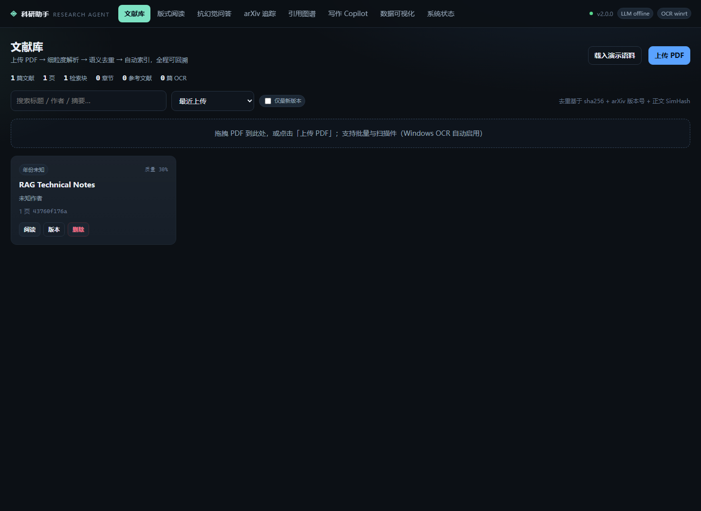

# AgentLit · 科研助手 Agent 平台

> 面向「真实学术研究 + 论文写作」场景的全栈式科研助手：从 PDF 导入、结构化解析、抗幻觉问答、
> 版式感知阅读与双语对照，到文献追踪推荐、局域引用图谱、自动综述与写作 / 数据可视化 Copilot。

本仓库前身为一个 Streamlit + Chroma 的 RAG 原型（保留在 `legacy/`，历史提交可追溯），
在**不重写 Git 历史**的前提下，按竞赛六大命题完成全栈重构：旧原型 14 次提交之上，按阶段追加功能分支与 `--no-ff` 合并（`git log --graph` 可完整回溯，过程记录见 `docs/DEVLOG.md`）。



## 快速开始

```bash
# 1) 依赖（Python 3.11+；仅 8 个纯 Python 包，无 Node/npm、无前端构建）
python -m pip install -r backend/requirements.txt

# 2) 一键启动（自动建库、导入 fixtures 语料，离线确定性模式）
python scripts/run_server.py --demo
```

打开 <http://127.0.0.1:8000> 即可体验完整闭环：

1. **文献库**：14 篇合成论文 + 1 份扫描件（60 页）已入库，质量分、OCR 标记、版本关系可见；
2. **版式阅读**：150 DPI 原版页面 + bbox 覆盖层，标题树、引用双向跳转、中英对照/双语并排；
3. **抗幻觉问答**：每个结论绑定 `[E1]` 证据角标（页码 + bbox + 原文），点击回到原文位置；
4. **arXiv 追踪**：离线镜像检索 → 代码可得性加权 → 一键入库/点赞踩 → Sickle 风格定时追踪；
5. **引用图谱**：14 节点引用拓扑，PageRank/介数中心性 → 基石论文与边缘论文；
6. **写作 Copilot**：无幻觉大纲（References 只来自本地库）、TikZ/Graphviz/Mermaid/Matplotlib 脚本；
7. **数据可视化**：上传 CSV → 确定性 SVG（折线/柱状/散点/三维雷达/表格）+ 学术 Figure Caption + matplotlib 复现脚本。

无网络环境下系统自动进入**离线确定性模式**：解析、检索、抽取式问答、图谱、综述、图表全部由本地算法完成；
配置 `DEEPSEEK_API_KEY` / `SILICONFLOW_API_KEY` 后改用 `--online` 启动即自动切换在线大模型增强，失败时自动降级并显式标注。

## 六大命题模块

| 模块 | 能力 | 主要实现 |
| --- | --- | --- |
| 一 · 文献管理 | 单/批量上传、sha256 + 标题 + SimHash 语义去重、版本族与「保留最新」、扫描件 OCR、一至三级标题树、表格/图/公式/参考文献/附录 | `backend/app/parsing/`、`backend/app/papers/service.py` |
| 二 · 抗幻觉问答 | BM25 ⊕ 向量 RRF 混合检索、页码 + bbox 锚点、逐句/数值校验、9 维跨文献对比表 | `backend/app/indexing/`、`backend/app/qa/` |
| 三 · 版式阅读 | 服务端页面栅格 + 结构化块、`[n]` ↔ References 双向跳转、划词/整篇翻译、中英对照同步滚动、Markdown/HTML/原位 PDF 导出 | `backend/app/reading/`、`frontend/assets/reader.js` |
| 四 · 发现追踪 | arXiv 检索（在线/离线镜像）、引用含金量筛选、GitHub 代码优先、推荐理由、点赞踩反馈、定时追踪 | `backend/app/discovery/` |
| 五 · 图谱综述 | 引用拓扑、PageRank/介数/社区、基石与边缘论文、Future Work 提炼并排除已解决方向 | `backend/app/graph/` |
| 六 · 写作 Copilot | 无幻觉 Abstract/Intro/Related Work/References、四类拓扑图脚本、CSV → 图表 + Caption、中译英 | `backend/app/writing/`、`backend/app/dataviz/` |

命题逐条映射与验证命令见 [docs/COMPETITION_MATRIX.md](docs/COMPETITION_MATRIX.md)，架构与 ADR 见
[docs/ARCHITECTURE.md](docs/ARCHITECTURE.md)，开发历程与关键 bug 复盘见 [docs/DEVLOG.md](docs/DEVLOG.md)。

## 架构一览

```
frontend/  原生 ES Module SPA（hash 路由，8 个视图，零构建）
   │  REST / JSON（51 条接口）
backend/app/
   api/        参数校验、错误翻译、响应整形（papers / reading / qa / discovery / graph / writing / dataviz / system）
   parsing/    PyMuPDF 版面块 → 标题树 / 表格 / 图 / 公式 / 参考文献 / 附录（含 OCR）
   indexing/   分块 + meta 块 + 确定性向量 + BM25 + RRF 融合
   qa/         单篇问答、9 维对比、引用锚点、claim 校验
   reading/    阅读视图装配、引用双向链接、翻译缓存、四种导出
   discovery/  arXiv 检索/追踪、推荐、反馈
   graph/      引用图、图论指标、领域综述与 Future Work
   writing/    无幻觉大纲、拓扑图脚本、学术翻译
   dataviz/    CSV 画像、确定性 SVG、Figure Caption、matplotlib 脚本
   providers/  LLM / Embedding / OCR / arXiv 四类能力网关（在线优先、离线降级）
   core/ db/   配置、日志、异常、哈希、文本工具；SQLite 仓储
backend/{tests,eval}/   48 个 unittest；八段可复现评测
fixtures/papers/        15 个 PDF（含扫描件 scanned/udl_scan.pdf）
fixtures/corpus/        14 篇论文真值 JSON；生成脚本 scripts/make_corpus.py；离线镜像 fixtures/arxiv/mirror.json
```

设计取舍：阅读器不使用 PDF.js，改为**服务端栅格化 + 结构化 bbox**（任何环境版式一致、锚点像素级可定位）；
上传走 raw body 规避 `python-multipart`；图表自研 SVG 渲染 + matplotlib 脚本导出；所有 ID 由内容哈希派生。

## 评测结果（`python -m eval.run_eval`，离线，2026-11-01）

| 指标 | 结果 |
| --- | --- |
| 解析成功率 / 平均质量 | **100%** / **0.971**（14 篇，含扫描件 OCR `winrt`） |
| 表格 / 参考文献覆盖 | 13/14 篇抽到表格；13/14 篇抽到参考文献 |
| 问答金标准命中 | **104/115 = 90.4%**（作者 14/14、机构 14/14、超参 29/29、硬件 10/10、指标 18/18） |
| 引用锚点覆盖 / 校验通过 | **100%** / 62.6% |
| 跨文献对比 | 维度覆盖 100%，12/12 单元格有锚点，GPT 参数量 117M/1.5B/175B 全部命中 |
| 引用图谱 | 14 节点 / 10 边，PageRank 识别 2 篇基石论文 |
| 写作引用校验 | 六节齐全、References 全部来自本地库、正文编号双向一致 |
| 图表确定性 | 相同输入两次渲染 SVG 字节一致 |

完整报告见 [docs/EVALUATION.md](docs/EVALUATION.md) 与 `backend/eval/report.json`。

## 测试与复现

```bash
cd backend
python -m unittest discover -s tests -v     # 48 tests OK（约 12s）
python -m eval.validate_corpus               # 逐篇解析质量检查
python -m eval.run_eval                      # 八段评测，输出 report.json + EVALUATION.md
```

复现性承诺：

- 实体 ID 由内容哈希派生（`sha1(pdf)[:16]`），同一文件重复导入结果稳定；
- 解析产物落盘 JSON，可逐字段核对；页面图固定 150 DPI；
- 检索、图谱布局（seed=20260101）、图表几何均为确定性算法；
- 所有降级（在线 LLM/向量/arXiv 不可用）在 `GET /api/system/status` 与前端「系统状态」显式标注，不做静默伪装。

## 团队信息

| 项目 | 内容 |
| --- | --- |
| 队伍名称 | （待补充：参赛队伍名称） |
| 所属单位 | （待补充：学校 / 学院 / 团队） |
| 团队成员与分工 | （待补充：姓名 — 负责模块，例如 成员 A — 解析与检索；成员 B — 前端与阅读器；成员 C — 图谱、写作与评测） |
| 联系方式 | （待补充：队长邮箱或其他有效联系方式） |

> 以上为赛方 2.1 要求的团队信息字段；因当前材料未提供，先以占位符标注，确认后替换即可。
> 代码与提交历史：`git log --oneline --graph`（旧原型 14 次提交 + 分阶段功能分支与 `--no-ff` 合并）。

## 在线演示

| 项目 | 内容 |
| --- | --- |
| 演示地址 | （待补充：可公网访问的部署地址，例如 `https://<domain>/`） |
| 可用时间 | （待补充：评审期间的服务开放时段） |
| 评审账号 | 无需登录即可使用；若部署环境增加鉴权，请在此补充（待补充：测试账号 / 口令） |

本地等价演示：`python scripts/run_server.py --demo`（`http://127.0.0.1:8000`，数据与截图均取自该模式）。

## 提交材料

| 材料 | 位置 | 说明 |
| --- | --- | --- |
| 技术文档（PDF，≤30 页） | [docs/TECHNICAL_REPORT.pdf](docs/TECHNICAL_REPORT.pdf) | 由 [docs/TECHNICAL_REPORT.md](docs/TECHNICAL_REPORT.md) 生成，14 页 |
| 技术文档源文件 | [docs/TECHNICAL_REPORT.md](docs/TECHNICAL_REPORT.md) | 可编辑版本，含架构图源文件 [docs/assets/architecture.svg](docs/assets/architecture.svg) |
| 提交材料清单 | [docs/SUBMISSION_MATERIALS.md](docs/SUBMISSION_MATERIALS.md) | 2.1 / 2.3 / 2.4 逐项状态与待补充项 |
| 环境配置 | [backend/.env.example](backend/.env.example)、[backend/requirements.txt](backend/requirements.txt) | 环境变量模板 + 依赖清单 |
| 架构与命题映射 | [docs/ARCHITECTURE.md](docs/ARCHITECTURE.md)、[docs/COMPETITION_MATRIX.md](docs/COMPETITION_MATRIX.md) | 设计决策、接口清单、六模块逐条验证 |
| 评测报告 | [docs/EVALUATION.md](docs/EVALUATION.md) | 八段可复现评测与逐篇明细 |

重新生成 PDF（需要本机安装 Edge；无网络也可用）：

```bash
python scripts/build_report_pdf.py        # Markdown → HTML → docs/TECHNICAL_REPORT.pdf（自动校验页数与章节）
```

## 已知边界

- 离线问答为**抽取式**：不生成新句子，得分靠 BM25/向量召回与规则打分；citation / Future Work 类问题仍有提升空间（7/13、1/3）；
- OCR 依赖 Windows.Media.Ocr（`winrt`）或 Tesseract，Linux 评测机无 OCR 引擎时自动回退文本层并标注 `degraded`；
- 阅读器页面为图片，文本选择通过 bbox 覆盖层实现，复制长段落需逐块操作；
- 单进程 uvicorn + SQLite WAL，适合单机演示，未做多租户并发压测。
