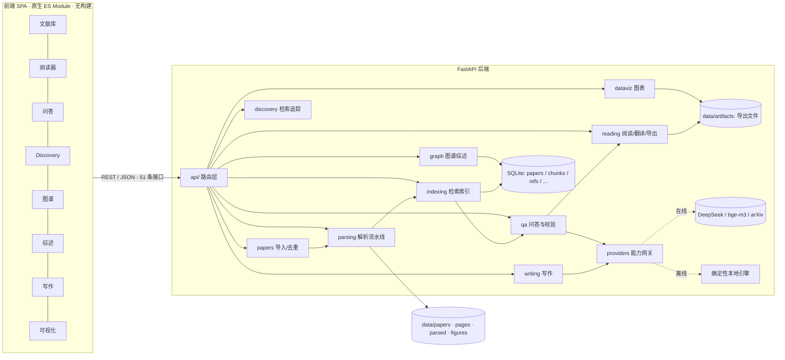

# 架构设计

## 1. 目标与约束

**目标**：以竞赛六大命题为准绳，构建「可导入 → 可解析 → 可问答 → 可阅读 → 可追踪 → 可成图 → 可写作」的
全栈科研助手，且每一条输出都具备**可审查、可定位、可复现**三种属性。

**硬约束**（离线评测机上同样成立）：

| 约束 | 影响 | 应对 |
| --- | --- | --- |
| 评测机可能无外网 | 不能依赖 CDN / npm / 在线模型 | 前端零依赖原生 ES Module；LLM、向量、arXiv 双通道可降级 |
| 不允许安装浏览器 PDF 插件 | 不能用 PDF.js 渲染 | 服务端栅格化页面 + 结构化 bbox 图层（ADR-002） |
| 不引入重型二进制依赖 | 不用 Chroma / pandas / matplotlib / pytest | SQLite + numpy/networkx 自研索引；自研 SVG 绘图器（ADR-004） |
| 输出必须可复现 | 禁止随机、禁止时间相关输出 | 内容哈希 ID、固定种子布局、纯函数式渲染（ADR-005） |

## 2. 总体架构



**分层原则**

- `api/` 只做参数校验、错误翻译、响应整形，不写业务逻辑；
- 业务模块只依赖 `core/`、`db/`、`providers/` 的稳定接口，不直接读环境变量；
- `providers/` 是唯一「外部世界接口」，在线/离线实现遵循同一协议，运行时探测切换；
- 所有写操作返回产物 ID 与可再审阅的中间结果（解析 JSON、检索 trace、引用锚点）。

## 3. 模块职责

| 目录 | 职责 | 关键产物 |
| --- | --- | --- |
| `app/core/` | 配置、日志、异常、哈希、文本工具、时钟 | 统一错误响应 `{error:{code,message,detail,field}}` |
| `app/db/` | SQLite 连接池（WAL）、schema、仓储函数 | `data/app.db` |
| `app/providers/` | LLM / Embedding / OCR / arXiv 四类网关 | `/api/system/status` 能力矩阵 |
| `app/parsing/` | PDF → `ParsedPaper`：版面块、标题树、表格、图、公式、参考文献、附录、OCR | `data/parsed/{id}.json` |
| `app/papers/` | 上传、去重判定、入库、索引、版本比较、删除 | `data/papers/{id}.pdf` |
| `app/indexing/` | 分块（含 meta 块）、确定性向量、BM25、RRF 检索、邻块扩展 | `chunks`/`embeddings` 表 |
| `app/qa/` | 单篇问答、9 维跨文献对比、引用锚点、claim 校验 | answer + `citations[]` |
| `app/reading/` | 阅读视图装配、`[n]`↔References 双向链接、翻译缓存、四种导出 | 页面块布局 / 译文 / 导出文件 |
| `app/discovery/` | arXiv 检索与追踪、本地库相关度、代码优先、反馈推荐 | `discovery`/`track_*` 表 |
| `app/graph/` | 引用图构建、PageRank/介数/社区、基石识别、综述与 Future Work | `graphs`/`surveys` 表 |
| `app/writing/` | 无幻觉大纲、四类图脚本、学术翻译 | `outlines` 表 + 脚本源码 |
| `app/dataviz/` | CSV 画像、确定性 SVG、Figure Caption、matplotlib 脚本 | `datasets`/`charts` 表 |

## 4. 数据模型（SQLite）

| 表 | 关键列 | 说明 |
| --- | --- | --- |
| `papers` | `id`(sha1[:16]), `sha256`, `title`, `title_norm`, `authors`(JSON), `affiliations`(JSON), `abstract`, `year`, `venue`, `arxiv_id`, `arxiv_version`, `doi`, `pages`, `ocr_used`, `ocr_engine`, `layout`, `parse_quality`(JSON), `version_group`, `is_latest`, `doc_simhash` | 文献主表；同 `version_group` 构成版本族 |
| `sections` | `paper_id`, `sid`, `level`, `number`, `title`, `page`, `end_page`, `path`, `appendix`, `block_ids` | 标题树扁平存储，`path` 保留层级 |
| `chunks` | `chunk_id`, `paper_id`, `sid`, `page`, `x0..y1`, `text`, `order_idx`, `token_len`, `kind` | 检索最小单元，带版面锚点；`kind=meta` 为元信息块 |
| `embeddings` | `chunk_id`, `model`, `dim`, `vec` | float32 小端 BLOB |
| `refs` | `paper_id`, `ref_idx`, `raw`, `title`, `authors`, `year`, `doi`, `arxiv_id`, `matched_paper`, `match_score`, `value_score` | 参考文献与本地匹配 |
| `edges` | `src`, `dst`, `kind`, `weight`, `evidence` | 引用边（ref 编号 + 匹配分） |
| `translations` | `paper_id`, `lang`, `scope`, `anchor`, `src_hash`, `text`, `provider` | 译文缓存，按源文本哈希失效 |
| `qa_log` | `question`, `paper_ids`, `answer`, `citations`, `verified`, `confidence`, `provider`, `trace` | 问答审计与历史 |
| `discovery` | `arxiv_id`, `title`, `abstract`, `published`, `github`, `imported_paper` | arXiv 缓存与入库映射 |
| `feedback` / `users` | `user_id`, `target`, `action`, `weight` | 点赞/踩/收藏，驱动推荐 |
| `track_topics` / `track_state` | `topic`, `category`, `keywords`, `last_run` | Sickle 风格追踪 |
| `graphs` / `surveys` / `outlines` / `datasets` / `charts` | `id`, `payload`, `created_at` | 各模块产物 |
| `jobs` / `traces` | `id`, `kind`, `status`, `detail` | 长任务与 Agent 决策轨迹 |

## 5. 确定性设计

1. **ID**：`paper_id = sha1(pdf_bytes)[:16]`，`chunk_id = sha1(paper_id|page|order|text)[:16]`；
2. **向量**：默认 `HashingEmbedder`——词 + 字符三元组 CRC32 哈希到 1024 维并 L2 归一化，纯确定性；
3. **检索**：BM25(k1=1.5, b=0.75) 与余弦向量各自排序后 RRF(k=60) 融合，再按意图加权（meta ×2.2、`[n]` 引用块 ×2.4）；
4. **布局**：图谱 spring layout 固定 `seed=20260101`；SVG 坐标统一 `round(x,2)`；
5. **图表**：自研 SVG 生成器不依赖时间/随机，相同 spec 两次字节一致（评测断言）；
6. **去重**：sha256 精确 → arXiv 版本族 → 标题相似度 + 正文 SimHash（有符号 64 位存储）；
7. **评测**：`python -m eval.run_eval` 在临时目录重放全流程并输出指标 JSON。

## 6. 能力降级矩阵

| 能力 | 在线实现 | 离线实现 | 探测方式 |
| --- | --- | --- | --- |
| 文本生成 | DeepSeek Chat（OpenAI 兼容协议） | 抽取式模板引擎（证据句 + 规则 + 引用回挂） | `LLM_MODE=auto` 时 GET `/models`，8s 超时 |
| 向量化 | bge-m3 (SiliconFlow) | HashingEmbedder（1024 维） | 同上；失败自动回落并记录 degraded |
| OCR | — | Windows.Media.Ocr（`winrt`）→ Tesseract → 文本层 | 启动探测 `winocr.ps1` / `tesseract` 可执行文件 |
| arXiv | Atom API `export.arxiv.org` | `fixtures/arxiv/mirror.json`（9 条） | 在线请求异常即回落，响应 `degraded=true` |

所有降级都会在 `/api/system/status`、问答响应 `provider/degraded` 与前端「系统状态」页显式标注，**不做静默伪装**。

## 7. 接口一览（前缀 `/api`，共 51 条）

- 系统：`GET /health`、`GET /system/status`、`POST /demo/seed`、`POST /demo/reset`
- 文献：`POST /papers/upload?filename=`、`POST /papers/batch`、`GET /papers`、`GET /papers/search`、
  `GET|DELETE /papers/{id}`、`GET /papers/{id}/parsed|file|versions`、`GET /papers/{id}/compare?other=`、
  `POST /papers/reindex`、`GET /papers/{id}/pages/{n}.png`
- 阅读：`GET /papers/{id}/document`、`GET /papers/{id}/outline`、`GET /papers/{id}/citations`、
  `POST /papers/{id}/translate`、`POST /papers/{id}/export`、`GET /papers/{id}/export/{fmt}`
- 问答：`POST /qa/ask`、`POST /qa/compare`、`GET /qa/history`、`GET /qa/dimensions`、`GET /qa/status`
- 发现：`POST /discovery/search|import|feedback|track`、`POST /discovery/references/{paper_id}`、
  `GET /discovery/recommend`、`GET /discovery/status`
- 图谱：`POST /graph/build|survey`、`GET /graph`、`GET /graph/{id}`、`GET /graph/{id}/export`、
  `GET /graph/surveys`、`GET /graph/surveys/{id}`
- 写作：`POST /writing/outline|diagram|translate`、`GET /writing/outlines`、
  `GET /writing/outlines/{id}`、`POST /writing/outlines/{id}/export`
- 可视化：`GET|POST /dataviz/datasets`、`GET /dataviz/datasets/{id}`、`GET|POST /dataviz/charts`、
  `GET /dataviz/charts/{id}`、`GET /dataviz/charts/{id}.svg`

## 8. 关键决策记录（ADR）

| 编号 | 决策 | 理由 | 代价 |
| --- | --- | --- | --- |
| ADR-001 | 前端零构建（原生 ESM + hash 路由） | 评测机与开发机均可能无网，`npm install` 不可用 | 无框架生态，需自写路由/状态/渲染 |
| ADR-002 | 页面由服务端渲染 PNG，叠加结构化 bbox | 任何环境版式一致、锚点像素级可定位 | 页面不可文本选择，需覆盖层实现选区与翻译 |
| ADR-003 | 上传走 raw body（`?filename=`） | 避免 `python-multipart` 强依赖 | 前端逐文件发送，批量另用 base64 JSON |
| ADR-004 | 自研 SVG 图表 + matplotlib 脚本导出 | 渲染确定、可离线；脚本作为可复现产物保留 | 图表样式需自行实现 |
| ADR-005 | 双通道 Provider + 显式降级 | 无网仍可演示全部模块，且行为可观测 | 离线答案为抽取式，不以自然语言生成见长 |
| ADR-006 | 元数据用 SQLite，二进制落文件系统 | 单文件部署、零服务依赖，便于评测机复现 | 并发写入需串行化（uvicorn 单 worker） |
| ADR-007 | 参考文献只从本地库生成 | 写作模块「无幻觉」的硬约束：模型不能补条目 | 需要先导入足够文献 |

## 9. 运行与评测

```bash
python -m pip install -r backend/requirements.txt

# 启动（--demo 会先导入 fixtures 中的 15 个 PDF）
python scripts/run_server.py --demo                 # 离线确定性模式
python scripts/run_server.py --online --demo        # 有 Key 时启用在线模型

# 重新生成合成语料（幂等）
python scripts/make_corpus.py --out fixtures/papers --mirror fixtures/arxiv/mirror.json

# 测试与评测
cd backend
python -m unittest discover -s tests -v             # 48 tests
python -m eval.validate_corpus                      # 逐篇解析质量
python -m eval.run_eval                             # 八段评测 → docs/EVALUATION.md
```
