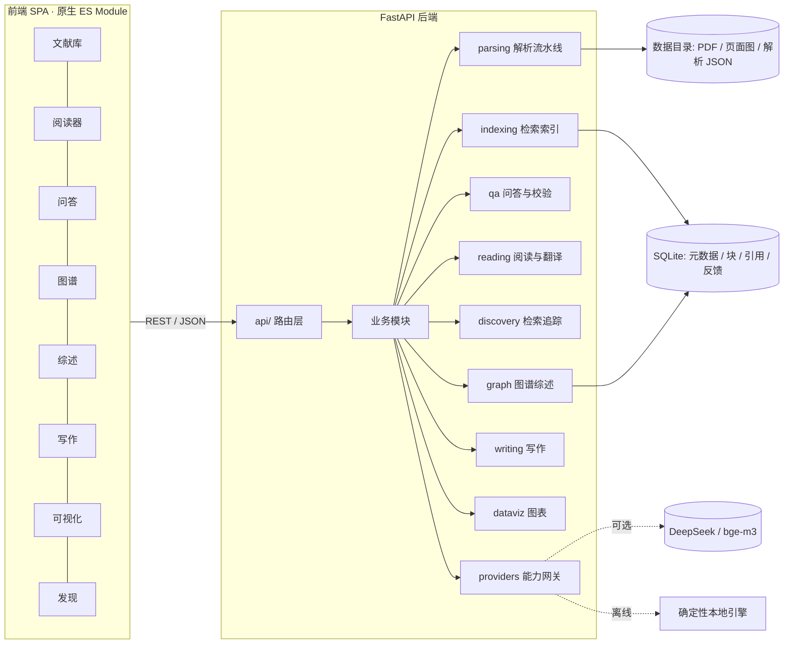

# 架构设计

## 1. 目标与约束

**目标**：以竞赛六大命题为准绳，构建「可导入 → 可解析 → 可问答 → 可阅读 → 可追踪 → 可成图 → 可写作」的
全栈科研助手，且每一条输出都具备**可审查、可定位、可复现**三种属性。

**硬约束**（离线评测环境下同样成立）：

| 约束 | 影响 | 应对 |
| --- | --- | --- |
| 评测机可能无外网 | 不能依赖 CDN / npm / 在线模型 | 前端零依赖原生 ES Module；LLM、向量、arXiv 全部双通道可降级 |
| 不允许安装浏览器 PDF 插件 | 不能用 PDF.js 渲染 | 服务端栅格化页面 + 结构化 bbox 图层（ADR-002） |
| 不引入重型二进制依赖 | 不用 Chroma / pandas / matplotlib | SQLite + numpy 自研索引；自研 SVG 绘图器（ADR-004） |
| 输出必须可复现 | 禁止随机、禁止时间相关输出 | 内容哈希 ID、固定种子布局、纯函数式渲染（ADR-005） |

## 2. 总体架构



**分层原则**

- `api/` 只做参数校验、错误翻译、响应整形，不写业务逻辑；
- 业务模块只依赖 `core/`、`db/`、`providers/` 的稳定接口，不直接读环境变量；
- `providers/` 是唯一的「外部世界接口」，在线/离线实现遵循同一协议，可在运行时探测切换；
- 所有写操作返回**产物 ID 与可再审阅的中间结果**（如解析 JSON、检索 trace），供前端展示。

## 3. 模块职责

| 目录 | 职责 | 关键产物 |
| --- | --- | --- |
| `app/core/` | 配置、日志、异常、哈希与文本工具 | 统一错误响应 `{code,message,detail}` |
| `app/db/` | SQLite 连接、schema 迁移、仓储函数 | `data/app.db` |
| `app/providers/` | LLM / Embedding / OCR / arXiv 四类能力网关 | 运行时能力矩阵 `/api/health` |
| `app/parsing/` | PDF → `ParsedDocument`：版面块、标题树、表格、公式、参考文献、附录、OCR | `data/parsed/{id}.json`、页面 PNG |
| `app/indexing/` | 分块、确定性向量、BM25、RRF 融合检索 | `chunks` 表 + trace |
| `app/qa/` | 单篇问答、多文对比、引用锚点、claim 校验 | answer + citations[] |
| `app/reading/` | 阅读视图装配、引用双向跳转、翻译缓存 | 页面块布局 / 译文锚点 |
| `app/discovery/` | arXiv 检索与追踪、引用含金量评分、个性化推荐 | `discovery_*` 表 |
| `app/graph/` | 引用图构建、图论指标、基石/边缘识别、综述与 Future Work | graph JSON / survey markdown |
| `app/writing/` | 无幻觉大纲、四类图脚本生成 | markdown + 脚本源码 |
| `app/dataviz/` | CSV 画像、SVG 图表、Figure Caption、matplotlib 脚本导出 | SVG + caption + .py |

## 4. 数据模型（SQLite）

| 表 | 关键列 | 说明 |
| --- | --- | --- |
| `papers` | `id`(sha1), `sha256`, `title`, `title_norm`, `authors`, `affiliations`, `abstract`, `year`, `venue`, `arxiv_id`, `doi`, `pages`, `ocr_used`, `version_group`, `is_latest`, `parse_quality` | 文献主表；`version_group` 相同的多行构成版本族 |
| `sections` | `paper_id`, `sid`, `level`, `number`, `title`, `page_start`, `path` | 标题树扁平存储，`path` 保留层级 |
| `chunks` | `chunk_id`, `paper_id`, `sid`, `page`, `bbox`, `text`, `order_idx`, `token_len` | 检索最小单元，带版面锚点 |
| `refs` | `paper_id`, `ref_idx`, `raw`, `title`, `authors`, `year`, `doi`, `arxiv_id`, `matched_paper`, `score` | 参考文献条目与本地匹配 |
| `edges` | `src`, `dst`, `kind`, `weight` | 引用边（`kind=cites/sim/topic`） |
| `embeddings` | `chunk_id`, `model`, `dim`, `vec` | float32 二进制 |
| `translations` | `paper_id`, `lang`, `anchor`, `src_hash`, `text`, `provider` | 译文缓存，按源文本哈希失效 |
| `users` / `feedback` | `user_id`, `target`, `action`, `ts` | 点赞/踩、导入行为，驱动推荐 |
| `jobs` | `id`, `kind`, `status`, `payload`, `result` | 长任务（批量解析、追踪刷新） |
| `traces` | `id`, `ts`, `module`, `action`, `detail` | Agent 决策轨迹，支撑「可解释」 |

## 5. 确定性设计

1. **ID**：`paper_id = sha1(pdf_bytes)[:16]`，`chunk_id = sha1(paper_id|page|order|text)[:16]`；
2. **向量**：默认 `HashingEmbedder`——字符 n-gram 哈希到 1024 维 + 词频饱和，纯确定性；
3. **检索**：BM25(k1=1.2,b=0.75) 与向量余弦各自归一化后 RRF(k=60) 融合，`trace` 输出两路原始分；
4. **布局**：图谱 spring layout 固定 `seed=20260101`、固定迭代次数；SVG 坐标统一 `round(x,2)`；
5. **去重**：先按 `sha256` 精确去重，再按标题规范化 + 摘要/正文 SimHash 做语义去重；
6. **评测**：同一语料两次运行，产物目录树文件哈希一致（`eval/run_eval.py` 断言）。

## 6. 能力降级矩阵

| 能力 | 在线实现 | 离线实现 | 探测方式 |
| --- | --- | --- | --- |
| 文本生成 | DeepSeek Chat（OpenAI 协议） | 抽取式模板引擎（基于检索证据拼接 + 规则归纳） | `LLM_MODE=auto` 时 1 次 8s 超时探测 |
| 向量化 | bge-m3 (SiliconFlow) | HashingEmbedder | 同上，失败即降级 |
| OCR | — | PyMuPDF 内嵌 OCR(如可用) / Tesseract(如可用) / 文本层回退 | 启动时探测可执行文件 |
| arXiv | Atom API | `fixtures/arxiv_offline.json` 镜像 | 启动时 HEAD 探测 |

所有降级都会在 `/api/health` 与前端「系统」页显式标注，**不做静默伪装**。

## 7. 接口一览（前缀 `/api`）

- 系统：`GET /health`、`GET /system/stats`、`POST /demo/seed`、`POST /demo/reset`
- 文献：`POST /papers/upload?filename=`、`GET /papers`、`GET /papers/{id}`、`DELETE /papers/{id}`、
  `POST /papers/dedup`、`GET /papers/{id}/outline`、`GET /papers/{id}/artifact`
- 阅读：`GET /papers/{id}/pages/{n}.png`、`GET /papers/{id}/reader?page=`、`GET /papers/{id}/references`、
  `GET /papers/{id}/figures|tables|formulas`、`POST /papers/{id}/translate`、`GET /papers/{id}/translation`
- 问答：`POST /qa/ask`、`POST /qa/compare`、`POST /qa/verify`、`GET /qa/history`
- 发现：`POST /discovery/search`、`POST /discovery/import`、`GET /discovery/recommend`、
  `POST /discovery/feedback`、`GET /discovery/track`、`POST /discovery/track/refresh`
- 图谱：`POST /graph/build`、`GET /graph/{id}`、`POST /graph/survey`、`POST /graph/future-work`
- 写作：`POST /writing/outline`、`POST /writing/diagram`、`GET /writing/export/{id}`
- 可视化：`POST /dataviz/datasets`（raw CSV）、`GET /dataviz/datasets`、
  `POST /dataviz/chart`、`GET /dataviz/chart/{id}.svg`、`GET /dataviz/chart/{id}.py`

## 8. 关键决策记录（ADR）

| 编号 | 决策 | 理由 | 代价 |
| --- | --- | --- | --- |
| ADR-001 | 前端零构建（原生 ESM + hash 路由） | 评测机与开发机均可能无网，`npm install` 不可用 | 无框架生态，需自写路由/状态管理 |
| ADR-002 | 页面由服务端渲染 PNG，叠加结构化 bbox | 保证任何环境下版式一致、锚点像素级可定位 | 页面不可文本选择，需覆盖层实现选区与翻译 |
| ADR-003 | 上传走 raw body（`?filename=`） | 避免 `python-multipart` 强依赖 | 需前端逐个文件发送 |
| ADR-004 | 自研 SVG 图表 + matplotlib 脚本导出 | 渲染确定、可离线；脚本作为可复现产物保留 | 图表样式需自行实现 |
| ADR-005 | 双通道 Provider + 显式降级 | 无网仍能演示全部模块，且行为可观测 | 离线答案为抽取式，不以自然语言生成见长 |
| ADR-006 | 元数据用 SQLite，二进制落文件系统 | 单文件部署、零服务依赖，便于评测机复现 | 并发写入需串行化（uvicorn 单 worker） |

## 9. 运行

```bash
python -m pip install -r backend/requirements.txt
python scripts/make_corpus.py --out fixtures/corpus      # 生成合成语料
python scripts/run_server.py --demo                      # 启动并灌库
python -m unittest discover -s backend/tests -v          # 测试
python backend/eval/run_eval.py                          # 评测与复现性断言
```
