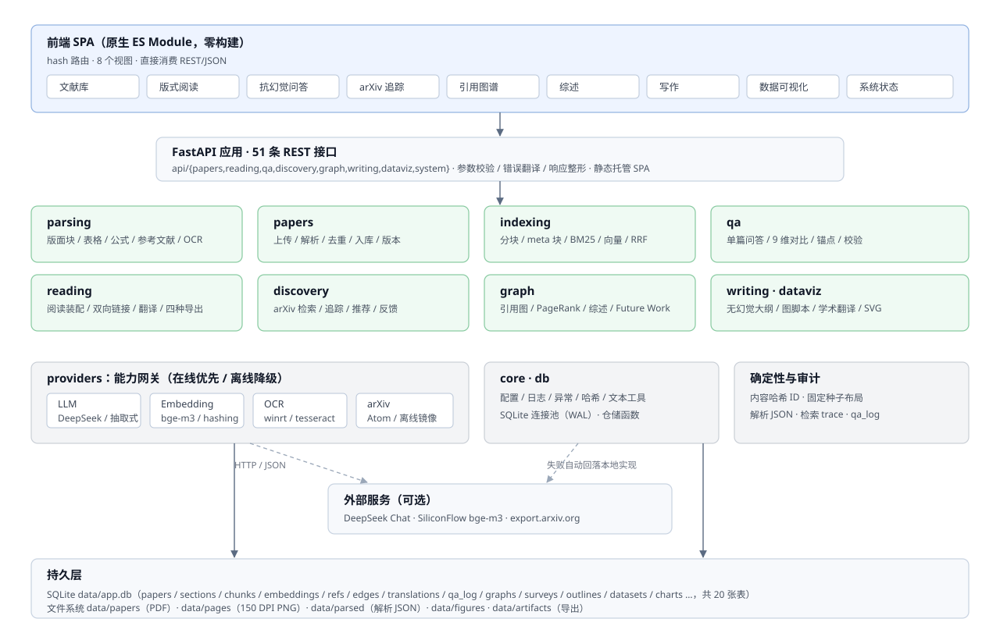
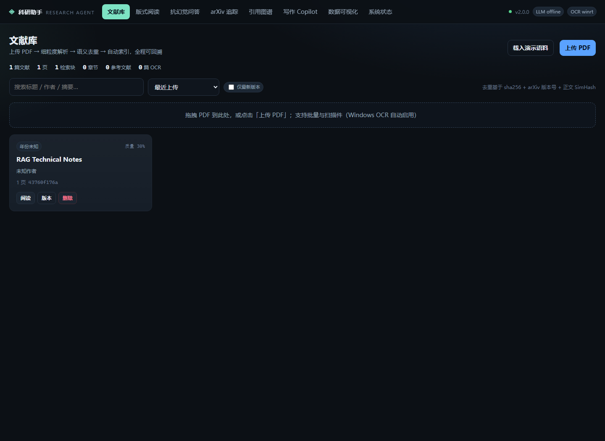
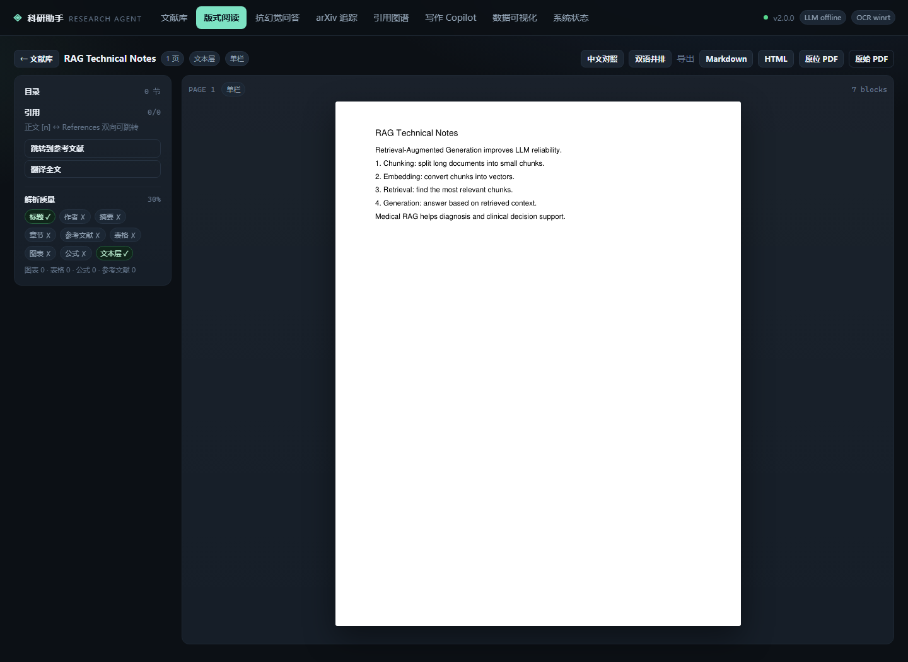
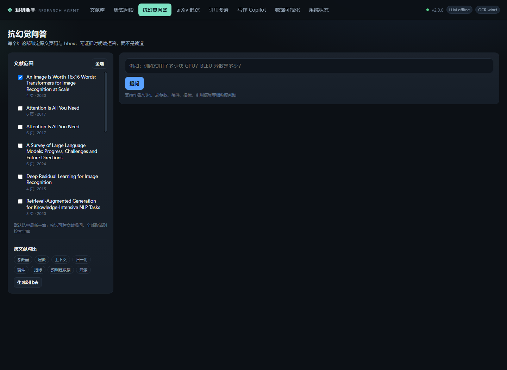
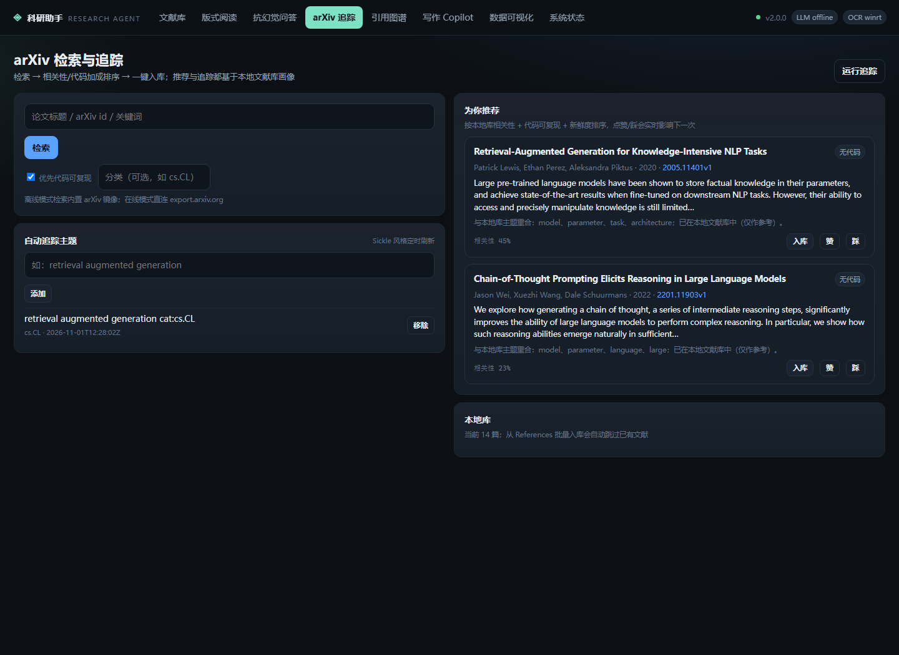
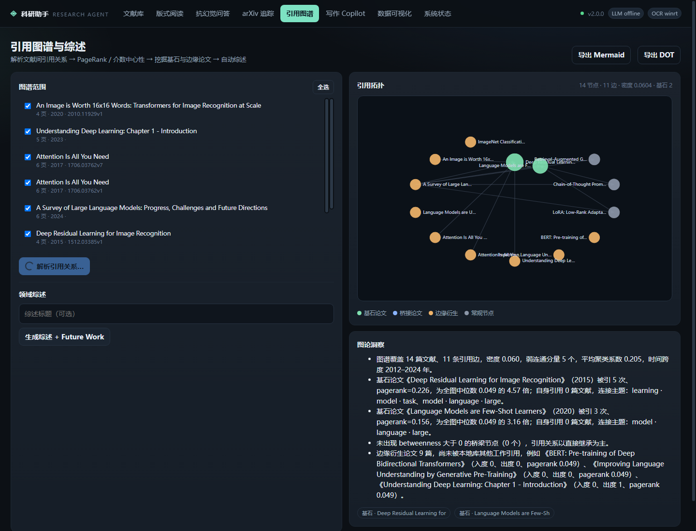
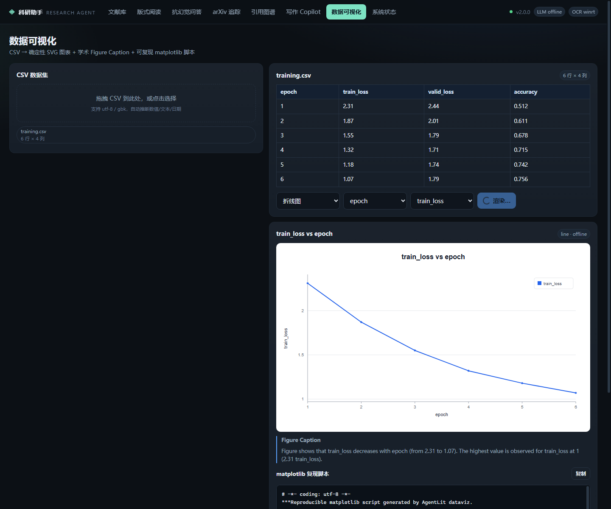

# AgentLit 科研助手 —— 项目介绍

> 文档版本：2026-11-15 · 适用版本：2.0 · 项目仓库：`cui1001/ai-literature-platform`

## 1 项目详情及使用方式

### 1.1 项目定位

AgentLit 是一个面向科研文献工作流的全栈助手：把 PDF 论文变成可检索、可定位、可对比、可追溯的结构化知识，并在其上提供问答、精读、引用网络、自动综述与写作辅助。它服务的对象包括需要快速消化大量论文的研究人员与研究生、需要把文献能力集成进内部系统的工程团队，以及需要可复现评测与可审计证据链的技术评审者。

平台的核心主张是「答案必须能回到原文」：每一条问答结论都带页面与文本块锚点，每一处引用都能从正文 `[n]` 跳到 References 条目并回跳，每一个图谱边都能说明是 arXiv ID 匹配还是标题匹配。系统在无网络环境下也能完成解析、索引、问答、图谱与写作的完整闭环。

### 1.2 规模与技术栈

| 维度 | 说明 |
|---|---|
| 后端 | FastAPI + SQLite（20 张表），51 个 REST 路径（54 个方法操作），8 个 API 路由模块 |
| 前端 | 原生 ES Module 单页应用，8 个视图（文库/阅读/问答/发现/图谱/写作/图表/系统），零 Node 构建 |
| 文档解析 | PyMuPDF 文本层 + 版面启发式；OCR 引擎链覆盖 EasyOCR、Windows OCR、Tesseract、PyMuPDF |
| 检索 | BM25 + 向量检索 + RRF 融合，支持中文查询扩展、意图加权、跨论文分路召回 |
| 图谱 | `networkx` 有向图 + PageRank/介数/聚类系数，引用边带匹配分数与证据 |
| 依赖 | 8 个纯 Python 包（在线大模型 SDK 可选），本地 `--demo` 与线上部署同一套代码 |
| 评测 | 14 篇合成真值论文 + 115 道评测题 + 39 篇真实 PDF 验收 + 9 个指定问题 |
| 文档 | README、ARCHITECTURE、COMPETITION_MATRIX、DEVLOG、EVALUATION、REVERIFICATION、PROJECT_INTRO |

### 1.3 功能模块

| 模块 | 主要职责 | 与其他模块的交互 |
|---|---|---|
| 论文库 `papers` | 上传/批量导入、PDF 魔数与大小校验、三级去重、版本族合并、页面图与文档结构输出 | 调用解析流水线；写 SQLite 与文件系统；为阅读器、问答、图谱提供论文与块 |
| 阅读器 `reading` | 版式还原（单/双栏）、块级 bbox 定位、标题树、引用链接、分段与整篇翻译、Markdown 导出 | 读取解析产物与 PDF 页面图；引用链接由问答的 citation 体系复用 |
| 问答 `qa` | 混合检索、证据组装、`[E#]` 引用、数值/引用校验、拒答策略、跨论文对比 | 依赖索引与解析块；输出 evidence 供前端高亮；对比复用检索结果 |
| 发现 `discovery` | arXiv 镜像检索、按标题/ID 导入、相似推荐、关注追踪、反馈记录 | 导入后走论文库流水线；推荐读取本地语料特征 |
| 图谱 `graph` | 参考文献匹配、引用有向图、中心性指标、基石/边缘识别、自动综述与 Future Work 抽取 | 依赖论文库的参考文献与标题索引；综述引用图谱指标 |
| 写作与可视化 `writing` / `dataviz` | 综述框架生成、章节草稿、真实参考文献注入、结构与引用检查；确定性图表规格生成（柱状/折线/散点/热力），同输入同输出 | 读取论文库与图谱；输出文稿与图表附件；图表不依赖随机数 |

数据流可以概括为一条主链：`PDF → 解析（块、结构、参考文献、页面图）→ 入库与去重 → 分块索引 → 检索/问答/图谱/综述 → 前端阅读与交互`。解析产物以 JSON 落盘，页面图按需渲染并缓存，索引与元数据写入 SQLite，因此同一份论文可以同时服务精读、问答与引用分析，而不需要重复解析。

### 1.4 快速开始

```bash
# 1) 克隆与安装
git clone https://github.com/cui1001/ai-literature-platform.git
cd ai-literature-platform
python -m pip install -r backend/requirements.txt

# 2) 本地演示（默认 8000 端口，自动切离线模式）
python scripts/run_server.py --demo

# 3) 单元测试
cd backend && python -m unittest discover -s tests

# 4) 可复现评测（输出 eval/report.json 与 docs/EVALUATION.md）
python -m eval.run_eval

# 5) 技术文档 PDF
python scripts/build_report_pdf.py
```

验收实例使用独立数据目录与离线三开关，避免污染开发库：

```bash
DATA_DIR=%TEMP%\agentlit_accept LLM_MODE=auto EMBED_MODE=hashing \
ARXIV_MODE=offline TRANSLATE_MODE=auto \
python -m uvicorn app.main:app --app-dir backend --host 127.0.0.1 --port 8030
```

关键环境变量与作用：

| 变量 | 取值 | 作用 |
|---|---|---|
| `DATA_DIR` | 任意目录 | 数据根目录（SQLite、PDF、页面图、解析 JSON、导出物） |
| `LLM_MODE` | `auto` / `online` / `offline` | 在线大模型可用时用在线，否则走离线抽取式引擎 |
| `EMBED_MODE` | `hashing` / `online` | 哈希向量（零依赖）或在线向量；离线验收用 `hashing` |
| `ARXIV_MODE` | `offline` / `online` | 离线走内置 arXiv 镜像，在线走官方接口 |
| `TRANSLATE_MODE` | `auto` / `deepseek` / `google` / `offline` | 翻译提供方链：DeepSeek → Google → MyMemory → 术语级 |
| `MAX_PAGES` / `PAGE_RENDER_LIMIT` | 整数 | 单文档页数上限与预渲染页数；超出部分页面图按需渲染 |

公网演示地址：`https://8-219-85-252.sslip.io`。服务器更新使用部署脚本，保持 systemd 与 Caddy 配置幂等：

```bash
ssh root@8.219.85.252
cd /opt/agentlit && git pull --ff-only && bash deploy/bootstrap.sh
```

`deploy/bootstrap.sh` 会创建 venv、安装依赖、按需补 swap、写入 `agentlit.service` 并重启，同时保留 `/etc/agentlit.env` 与 systemd drop-in 中的在线模型配置。

### 1.5 使用流程

1. **建库**：打开「文库」，拖入一个或多个 PDF；系统计算内容哈希、解析首页元数据、识别版式与参考文献，并在入库前完成去重与版本判定。重复文件直接提示“已存在”，同一论文的 v1/v7 进入版本族并保留最新，扫描件与对应文本版会被判为同一文献。
2. **精读**：进入「阅读」，左侧是标题树，中间是按原始版式渲染的页面图与文本块层，右侧是当前块的字体、坐标、所属章节与引用 inspector。点击任意块即可定位到原文位置，双栏论文保持左右栏阅读顺序。
3. **引用跳转**：正文中的 `[n]` 以热区形式覆盖在页面上；点击单编号直接跳到 References 对应条目并高亮，点击多编号（如 `[10, 39, 42]`）弹出选择列表；从 References 条目回跳时，正文对应热区闪烁提示。
4. **问答**：在「问答」中输入问题，可限定单篇或选择多篇。答案由证据句组成，句末带 `[E#]` 标记，下方列出每条证据的论文、页码、章节与原文；数值类结论会同时接受数字与引用校验，证据链不成立时明确拒答。
5. **跨文献对比**：选择两篇及以上论文，系统按 9 个维度（参数量、层数、上下文、归一化、预训练、数据、硬件、基准、代码）对齐信息，输出并排对比与差异说明。
6. **发现与追踪**：在「发现」中检索 arXiv 镜像、按标题或 ID 一键导入；对关注的作者/关键词建立追踪，运行后返回新增论文；对推荐结果给出“因为引用了…/主题相近…”的理由，并记录喜欢/不喜欢反馈。
7. **图谱与综述**：在「图谱」中选择 20 篇左右论文，生成引用网络、基石论文与边缘论文列表；一键生成综述，包含研究脉络、方法族、数据集与 Future Work 方向，每个方向都能回链到原文句子。
8. **写作**：在「写作」中选择主题与论文集合，生成章节框架与草稿，系统从真实文献库注入 References，并检查“引用是否存在、结构是否完整、论点是否有证据”。

## 2 项目亮点

### 2.1 离线优先的全栈可用性

解析、索引、问答、图谱、综述、写作在完全断网时仍可运行：嵌入使用哈希向量，LLM 使用抽取式离线引擎，arXiv 使用内置镜像，翻译使用术语级兜底。联网后同一套接口自动切换到在线模型与在线翻译，不需要改代码或重建索引。这让项目在竞赛验收、内网部署与断网演示三种场景下表现一致。

### 2.2 答案级抗幻觉，而不是只做检索

问答不是“把相似段落拼给用户”，而是先选证据句、再生成带 `[E#]` 的答案、最后做数值与引用校验。校验会先剥离引用编号、页码、arXiv ID 等噪声，再核对答案中的测量数字是否能在被引证据中找到；证据链不成立时返回拒答并说明原因。复验中 115 道题的校验通过率为 97.4%，9 个指定问题全部 `verified=true`、`refused=false`。

### 2.3 保留原始版式的阅读器

阅读器不是把 PDF 转成纯文本，而是保留页面图与文本块 bbox：单/双栏由行级几何判定，标题、作者、摘要、章节、图表、公式、参考文献各自成块，点击块可看到字体、坐标、所属章节与引用。正文引用热区直接使用 PDF 文本层坐标，与页面图共用同一坐标系，因此跳转位置精确到字符级。

### 2.4 正文 `[n]` 与 References 双向跳转

引用体系覆盖“正文 → References → 正文”的完整闭环：解析阶段为每条参考文献保留 `block_id` 与页码，链接阶段为每个 `[n]` 建立 occurrence，渲染阶段用 `page.search_for` 把标记映射为矩形热区。单编号单击直达，多编号弹出选择，回跳时闪烁原位置。复验中 Attention 论文生成 105 个引用 occurrence，全部带矩形坐标。

### 2.5 针对真实 PDF 的解析鲁棒性

解析器不是为理想 PDF 写的：arXiv 旋转水印先被识别为 `meta` 再参与标题选择，JMLR 页眉、版权行、Editor 行、页码不会污染元数据；双栏会议论文按栏还原阅读顺序；541 页书籍可以完整入库；纯图扫描件走英文 OCR 并重建块结构；参考文献同时支持 `[n]` 编号与作者-年份两种格式。39 篇真实论文验收中，37 篇唯一文献全部解析出参考文献（合计 2904 条），平均解析质量 0.994。

### 2.6 大文档与扫描件的工程处理

大文档只预渲染前 120 页，其余页面在首次访问时按需渲染并写入缓存，避免 500+ 页上传时生成上千张图片；OCR 按文档语言选择引擎，英文扫描件不会误用中文识别；扫描件与文本版通过内容与语义双重判重，避免同一论文重复入库。541 页《Understanding Deep Learning》在 133.1 秒内完成解析与入库。

### 2.7 可复现的评测与验收

仓库内置 14 篇合成真值论文与 115 道评测题，`eval.run_eval` 一条命令输出解析成功率、质量分、问答准确率、引用锚点率、校验通过率、图谱指标、写作与图表检查，并生成 `docs/EVALUATION.md`。真实语料侧另有 39 篇 PDF 审计、9 个指定问题与 F1–F10 功能验收记录，全部写入 `docs/REVERIFICATION.md`，每个数字都能追溯到具体论文与题目。

### 2.8 零构建前端与低依赖部署

前端是原生 ES Module，不需要 Node、npm 或打包步骤；后端依赖控制在 8 个纯 Python 包，SQLite 单文件存储，页面图与解析产物走文件系统。部署只需要 Python 与 Caddy，`deploy/bootstrap.sh` 幂等完成 systemd 服务、反向代理与 HTTPS 配置。

### 2.9 工程取舍以可验证为先

项目刻意避免引入重依赖与不可控的在线服务：嵌入默认使用哈希向量，图表生成使用确定性算法，评测数据全部本地化，解析与索引产物可离线复算。这让默认运行零外部依赖、任意一次评测都能在相同输入上复现相同结果；在线语义嵌入等增强能力可按需开启，离线稳定与在线效果兼得。

## 3 AI 测试技术落地使用情况概述

### 3.1 评测集构成

| 层级 | 规模 | 内容 |
|---|---|---|
| 合成真值语料 | 14 篇论文 + 15 个 PDF | 每篇带标题、作者、机构、摘要、章节树、表格、图、公式、参考文献与锚点真值，覆盖单栏/双栏、含/不含公式、长短文档等形态 |
| 评测题库 | 115 题 / 8 类 | 作者、机构、超参数、硬件、指标、方法对比、引用溯源、Future Work；每题带 gold 关键词与限定论文 |
| 真实语料审计 | 39 个 PDF | 含 541 页书籍、英文扫描件、双栏会议论文、arXiv 多版本、团队署名论文；逐篇记录标题/作者/机构/参考文献/页数/版式/质量/耗时 |
| 指定问题 | 9 题 | 单篇事实、数值、参考文献作者年份，以及 BERT/Transformer、GPT-1/GPT-2/GPT-3 的跨文献对比 |
| 功能验收 | F1–F10 | 文献管理、解析粒度、问答、版式阅读、标题树与引用跳转、翻译、检索追踪推荐、图谱、综述、写作 |

### 3.2 指标口径

| 指标 | 定义 | 当前结果 |
|---|---|---|
| 解析成功率 | 评测语料中成功解析并入库的比例 | 100% |
| 平均解析质量 | 质量检查项（摘要/章节/参考文献/表格/图/公式等）加权得分 | 0.981（合成语料）；0.994（39 篇真实验收） |
| 问答准确率 | 答案命中 gold 关键词且校验通过的题数 / 总题数 | 105/115 = 91.3% |
| 引用锚点覆盖率 | 答案中每条结论都能落到论文、页码与文本块的比例 | 100% |
| 校验通过率 | `verified=true` 的答案占已回答问题的比例 | 97.4% |
| 指定问题通过率 | 9 题全部 gold 关键词命中且 `verified=true`、`refused=false` | 9/9 |
| 图谱规模 | 20 篇验收语料的节点/边/基石/边缘 | 20 节点 / 43 边 / 基石 8 / 边缘 8 |
| Future Work 抽取 | 综述中可回链原文的方向条数 | 51 条 |
| 单元测试 | `unittest` 用例数 | 49 个，全部通过 |

指标口径统一为“可追溯到具体输入”：问答按题判定，解析按检查项判定，图谱按边与节点判定，所有结果写入 `eval/report.json` 与 `docs/EVALUATION.md`，真实语料结果写入 `docs/REVERIFICATION.md`。

### 3.3 测试执行方式

| 层次 | 做法 | 触发时机 |
|---|---|---|
| 单元测试 | 49 个 `unittest` 覆盖检索融合、问答校验、阅读布局、图谱构建、发现流程、写作检查、图表确定性 | 每次提交前 |
| 可复现评测 | `eval.run_eval` 跑解析、问答、对比、阅读、发现、图谱、写作、图表八段，输出报告 | 版本发布前 |
| 真实语料审计 | 39 个 PDF 逐篇入库，记录元数据、参考文献、版式、质量与耗时 | 解析器改动后 |
| 指定问题 | 9 题逐题记录 gold 命中、`verified`、`refused`、证据页码与耗时 | 问答/检索改动后 |
| 浏览器验收 | 用浏览器自动化实际操作阅读器：点热区、跳 References、回跳、检查高亮与滚动位置 | 前端改动后 |
| 功能验收 | F1–F10 逐项取证，每项都给出可复算的输入与输出 | 交付前 |
| 边界样本回归 | arXiv 水印、JMLR 页眉、双栏、541 页书籍、扫描件、无编号参考文献、多版本、团队署名 | 解析器改动后 |

### 3.4 回归节奏

项目把“能被复算”作为测试的第一原则：每次解析器改动先跑单篇探针，再跑 39 篇审计；每次检索或问答改动先跑 9 个指定问题，再跑 115 题评测；前端改动先在 8030 验收实例上做浏览器操作，再更新截图与文档。所有脚本都使用独立数据目录，避免测试数据污染开发库。

## 4 关键技术

### 4.1 纯 Python 全栈与零构建前端

后端只依赖 FastAPI、Uvicorn、Pydantic、PyMuPDF、NumPy、NetworkX、Pillow、python-dotenv，在线大模型 SDK 为可选项。前端使用原生 ES Module 与 History 路由，服务端只做静态托管与 API，不需要 Node 工具链。这样在离线 Python 3.14 环境中也能一条命令启动完整应用。

### 4.2 版面感知的解析流水线

解析以 PyMuPDF 的文本块为起点，先按页提取字体、字号、坐标与行信息，再用规则做分类：页眉页脚按纵向阈值剔除，arXiv 水印、JMLR 页眉、版权行、Editor 行、页码与 URL 被标记为 `meta`；标题在首页上半区按字号与垂直连续性选取；作者与机构逐行解析，支持“姓名/机构/邮箱”三行式、单行多姓名、团队署名与大括号邮箱组；摘要在双栏页面按标题所在栏取行，并修复跨行断词；参考文献按 `[n]` 或作者-年份两种模式切分。代码集中在 `backend/app/parsing/`。

### 4.3 三级去重与版本族

去重使用三层证据：PDF 字节 SHA-256 判同一文件；arXiv ID + 版本号判同一论文的不同版本；标题归一化 + 正文 SimHash 判语义近似（扫描件与文本版即依赖此层）。判定结果分为 `keep-existing`、`replace-existing`、`keep-both` 三种动作，版本族保留最新并记录版本标签。实现位于 `backend/app/parsing/dedupe.py` 与 `backend/app/papers/service.py`。

### 4.4 混合检索与查询扩展

检索层把 BM25 与向量结果用 RRF 融合（`rrf_k=60`），并在查询侧做扩展：中文问题映射到英文术语，英文问题补充同义词（如 context window → context size / nctx），指标题、引用题、参数题分别加权；跨论文问题按论文分路召回后合并，避免单篇长文挤占名额。关键短语（LayerNorm 位置、上下文长度、参数量级）会触发证据注入，把包含关键数字的块提到候选前列。

### 4.5 引用与校验

答案中的每条结论对应一个 evidence，编号为 `[E1]…[En]`，包含论文、页码、章节、文本与 bbox。校验器先剥离引用编号、页码、arXiv ID 等噪声，再检查答案中的数字是否出现在被引证据中；引用题额外检查参考文献条目是否存在。证据链不成立时输出拒答。实现位于 `backend/app/qa/citations.py` 与 `backend/app/qa/verifier.py`。

### 4.6 阅读器与引用热区

阅读器把页面图与文本块层叠加：块层是绝对定位的透明 div，保留 bbox 与 `block_id`；引用热区由 `page.search_for("[n]")` 得到矩形，再与 occurrence 的块 bbox 对齐。点击热区触发 References 定位，References 条目记录 `cited_by`，回跳时滚动到原块并闪烁。实现位于 `backend/app/reading/` 与 `frontend/assets/reader.js`。

### 4.7 引用图谱与自动综述

图谱先用 `LibraryIndex` 把每篇论文的参考文献匹配到库内论文：优先 arXiv ID，其次归一化标题，匹配成功即建边并记录分数与证据。图构建完成后计算 PageRank、介数与聚类系数，按入度与中心性识别基石论文与边缘论文。综述从章节标题与正文句子中抽取 Future Work（future work、limitation、open problem、we plan/hope 等模式），再聚合成方向并回链原文。实现位于 `backend/app/graph/`。

### 4.8 写作助手

写作模块提供综述框架模板（引言、方法族、数据集、对比、挑战、结论），按主题与论文集合生成章节草稿；References 从真实文献库注入，写作检查覆盖“引用是否存在、章节是否完整、论点是否有证据、格式是否一致”。实现位于 `backend/app/writing/`。

### 4.9 确定性数据可视化

图表模块把数据与图表类型映射为确定性的 SVG 规格：同一输入产生同一输出，不使用随机抖动；支持柱状、折线、散点、热力等常用科研图表，并保留轴标签、图例与数据点坐标。实现位于 `backend/app/dataviz/`。

### 4.10 在线/离线双引擎

Provider 层把 LLM、嵌入、翻译、arXiv、OCR 都抽象成可切换引擎：在线模式调用 DeepSeek 等模型，离线模式使用抽取式答案、哈希向量、术语级翻译与内置 arXiv 镜像；OCR 按文档语言排序引擎链（英文优先 EasyOCR/Tesseract，中文优先 Windows OCR）。切换只改环境变量，不改业务代码。

### 4.11 配置与运维

配置集中在 `backend/app/core/config.py`：数据目录、模式开关、页数上限、渲染上限、检索参数、上传大小等均可由环境变量覆盖；`reset_settings` 支持测试时切换独立数据目录与数据库。部署侧由 `deploy/bootstrap.sh` 写入 systemd 服务与 Caddy 配置，保留在线模型 drop-in，做到幂等更新。

### 4.12 存储与产物布局

SQLite 保存论文、作者、机构、章节、块、参考文献、边、问题、任务、反馈等 20 张表；文件系统保存 PDF 本体、页面图、解析 JSON、图表与导出物。页面图按 `{paper_id}/p{page}.png` 命名，首次访问按需渲染并缓存为 WebP/JPEG 派生图，兼顾清晰度与传输体积。

## 5 项目相关的图片/照片

### 5.1 总体架构



架构图展示从 PDF 接入、解析、索引、检索/问答、阅读器、图谱、写作到前端的完整链路，以及在线/离线双引擎的切换位置。

### 5.2 论文文库



文库视图展示论文列表、标题/作者/年份/页数/版式、解析质量与版本标签，支持搜索、排序、批量上传与删除。

### 5.3 阅读器



阅读器展示标题树、页面图、文本块层与块 inspector；点击块可查看字体、坐标、章节与引用，双栏论文保持左右栏顺序。

### 5.4 问答



问答视图展示问题、带 `[E#]` 的答案、证据列表与页码锚点；每条证据可跳转到原文位置。

### 5.5 发现



发现视图展示 arXiv 镜像检索结果、导入按钮、相似推荐与推荐理由，以及关注追踪与反馈入口。

### 5.6 图谱



图谱视图展示引用网络、节点角色（基石/边缘）、中心性指标与边证据，可下钻到具体参考文献。

### 5.7 数据可视化



图表视图展示按确定性规格生成的科研图表，支持柱状、折线、散点与热力等类型。

## 6 发表或获奖情况

暂无。

## 7 优化部分说明

### 7.1 项目来源与独立开发声明

本项目为独立开发，不是对第三方开源项目的二次封装。仓库首个提交即为自研代码；早期原型（Streamlit + Chroma 的单页 RAG）也由同一作者完成，保留在 `legacy/` 目录用于对照。当前版本是在该原型基础上重写而来，架构、解析、检索、问答、阅读器、图谱与测试体系均为重新设计。

### 7.2 原型基础

原型是一个 79 行的 Streamlit 单页应用：上传 PDF 后用 Chroma 建向量索引，BM25 做关键词召回，回答以单轮 RAG 拼接为主，配套 agent 冒烟与 RAG 评测脚本；原仓库约 34 个文件、1100 行代码。

### 7.3 优化前后对比

| 维度 | 原型（Streamlit + Chroma） | 当前版本 | 优化价值 |
|---|---|---|---|
| 架构 | 单页脚本，前端与逻辑耦合 | FastAPI 分层 + 原生 ES Module 前端，8 个视图 | 可维护、可扩展、可独立部署 |
| 数据层 | 无数据库，索引在内存/Chroma | SQLite 20 张表 + 文件系统产物 | 论文、块、引用、图谱、任务可持久化与查询 |
| 接口 | 无 REST API | 51 个路径 / 54 个操作，统一返回结构 | 前端、脚本、第三方系统都能复用 |
| 解析 | 纯文本抽取 | 版面感知：标题/作者/机构/摘要/章节/图表/公式/参考文献 + 页面图 | 元数据与结构可评测、可定位 |
| 去重 | 仅文件哈希 | 内容哈希 + arXiv 版本 + 标题/正文 SimHash | 扫描件、多版本、重复上传都能正确归并 |
| 检索 | 单轮向量 + BM25 | 混合检索 + RRF + 查询扩展 + 意图加权 + 跨论文分路 | 中文问题、指标题、引用题命中率显著提升 |
| 问答 | 拼接段落，无引用 | 证据句 + `[E#]` + 数字/引用校验 + 拒答 | 答案可追溯、可审计 |
| 阅读器 | 无 | 页面图 + bbox 块层 + 标题树 + 引用热区 + 翻译 | 保留原始版式，正文 `[n]` 可跳转可回跳 |
| 图谱/综述 | 无 | 引用图 + PageRank/介数 + 基石/边缘 + Future Work | 20 节点 43 边、51 条方向 |
| 写作/图表 | 无 | 框架生成 + 真实 References + 确定性图表 | 从读到写的闭环 |
| 离线能力 | 依赖在线模型与 Chroma | 在线/离线双引擎，哈希向量 + 抽取式问答 + 内置 arXiv 镜像 | 断网可演示、内网可部署 |
| 质量保障 | 2 个脚本 | 49 个单测 + 八段评测 + 39 篇审计 + 9 问 + F1–F10 | 每次改动可回归、结果可复算 |

### 7.4 迁移与重构步骤

改造按“先数据、再能力、后体验”推进：第一步替换存储与解析，把 PDF 变成带 bbox 的结构化块与参考文献；第二步建立索引与检索融合，接入问答、引用与校验；第三步补齐阅读器、图谱、综述、写作与图表；第四步把在线能力抽象成 provider，加入离线引擎与部署脚本；最后用评测、审计与浏览器验收把每条链路固化下来。整个过程保持单一代码库、单一部署入口，原型保留在 `legacy/` 作为对照。
