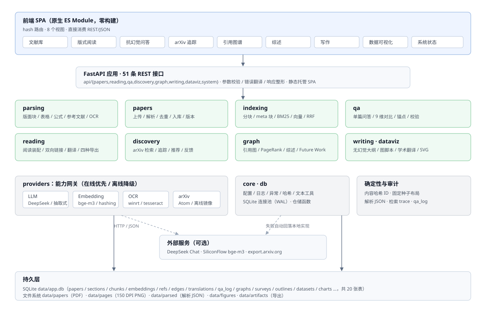

# AgentLit 科研助手 Agent 平台 — 技术文档

**版本**：v2.0.0 ｜ **代码基线**：`master`（完整分阶段提交与合并历史）｜ **文档日期**：2026-11-08 ｜ **运行形态**：单机全栈（FastAPI + SQLite + 原生 ES Module 前端）

> 本文档与仓库内 README、ARCHITECTURE、COMPETITION_MATRIX、EVALUATION、DEVLOG 保持一致；
> 所有指标均来自 `backend/eval/run_eval.py` 与 `backend/tests` 的真实运行结果，未做估算或补写。

## 摘要

AgentLit 面向真实学术研究与论文写作场景，围绕「PDF 导入 → 细粒度解析 → 抗幻觉问答 → 版式阅读与翻译 → 文献追踪推荐 → 引用图谱与综述 → 写作与数据可视化」构建全栈闭环。系统采用「在线优先、离线可完整运行」的双通道设计：在无网络、无 GPU、无 Node 构建环境的评测机上，仍能完成全部六大模块的确定性演示；配置大模型密钥后自动切换在线增强，失败自动降级并在接口与界面显式标注。

在 14 篇合成论文（含 1 份扫描件，共 60 页）上的可复现评测结果为：解析成功率 100%、平均解析质量 0.971；115 道金标准问答命中 104 题（90.4%），答案原文锚点覆盖 100%；跨文献对比 12/12 单元格带锚点；引用图谱 14 节点 / 10 边并识别 2 篇基石论文；写作模块的参考文献全部来自本地库并通过双向编号校验；图表 SVG 两次渲染字节一致。后端 48 个单元测试全部通过。

## 1 项目概述

### 1.1 背景与问题

科研人员在文献工作中面临四类高频、低效且易出错的环节：一是 PDF 版式复杂（双栏、公式、表格、扫描件），通用解析工具难以还原结构；二是大模型问答容易编造作者、机构、超参数、指标等细节，且缺少可核验的原文位置；三是跨文献对比与领域综述依赖人工逐篇翻阅；四是写作与绘图环节的引用、图注、脚本往往与真实文献脱节。

现有开源方案通常只覆盖单点：PDF.js 负责渲染但不产出结构；通用 RAG 框架负责检索但缺少版式锚点；绘图库负责出图但不可复现。本项目的目标是把这些单点整合为一个可审查、可验证、可复现的科研助手系统，并保留完整的开发过程记录。

### 1.2 建设目标

1. **全流程闭环**：从上传 PDF 到生成综述、大纲与图表，全部在同一个系统内完成，前后端可交互演示。
2. **输出可验证**：解析结果（JSON）、问答引用（页码 + bbox + 原文）、图谱边证据、图表生成脚本均可逐项核对。
3. **结果可复现**：内容哈希 ID、固定随机种子、确定性向量与渲染算法，使相同输入得到相同输出。
4. **环境自适应**：无网络时可离线运行全部模块；有网络时自动启用在线大模型与 arXiv 检索，并显式标注降级状态。

### 1.3 命题覆盖与交付范围

系统覆盖竞赛六大命题模块（PDF 管理与细粒度解析、抗幻觉问答与多文推理、版式感知阅读与双向翻译、论文检索追踪与推荐、局域引用图谱与综述、写作辅助与数据可视化），并满足三条基本要求（输入素材可审查、输出成果可验证、系统运行闭环）。各模块的状态、接口与验证命令见 `docs/COMPETITION_MATRIX.md`。

本次提交的文档材料包括：本技术文档（PDF，≤30 页）、README（项目介绍 / 技术架构 / 安装运行 / 团队信息）、环境配置说明（`.env.example` + `requirements.txt`）与提交材料清单。演示视频按本次要求不拍摄。

### 1.4 术语约定

| 术语 | 含义 |
| --- | --- |
| 块（block） | PDF 页面上具有统一版式属性的一段文本或图像，是解析与锚点的最小单位 |
| 锚点（anchor） | `{paper_id, page, bbox}` 三元组，用于把答案、图谱证据或译文定位回原文 |
| 离线确定性模式 | 不调用任何外部服务的运行模式，所有结果由本地算法产生 |
| 降级（degraded） | 在线能力不可用而回落到本地实现的状态，接口与界面均显式返回该标记 |

## 2 需求分析

### 2.1 用户与使用场景

| 角色 | 核心诉求 | 对应功能 |
| --- | --- | --- |
| 研究生 / 科研新手 | 快速读懂一篇论文，弄清作者、机构、超参数与指标 | 文献库、版式阅读、单篇问答 |
| 课题组成员 | 对比多篇论文的技术路线与演化 | 跨文献对比、引用图谱、综述 |
| 论文作者 | 找到真实可引用的文献，生成写作框架与图表 | 写作 Copilot、数据可视化 |
| 评审 / 教师 | 核验系统输出是否可信、是否可复现 | 解析 JSON、问答锚点、评测报告 |

### 2.2 功能需求

| 编号 | 模块 | 关键需求 | 验收要点 |
| --- | --- | --- | --- |
| F1 | PDF 管理与解析 | 单/批量上传、语义去重并建议保留最新、扫描件 OCR、标题树、表格、图、公式、参考文献、附录 | 14 篇语料解析成功率 100%；v1→v7 判定为版本关系 |
| F2 | 抗幻觉问答 | 单篇细粒度问答、多文对比，答案必须给出原文位置 | 115 题命中 ≥90%；锚点覆盖 100% |
| F3 | 版式阅读与翻译 | 双栏/公式/表格渲染、标题树、`[n]`↔References 双向跳转、整篇与块级翻译、双语同步滚动、多格式导出 | 阅读器可交互；导出含中文 PDF |
| F4 | 检索追踪与推荐 | arXiv 检索与入库、定时追踪、本地相关性推荐、代码可得性优先、点赞踩 | 离线镜像可检索；推荐含理由 |
| F5 | 引用图谱与综述 | 批量文献建图、基石/边缘识别、自动综述、Future Work 排除已解决方向 | 14 节点 10 边；2 篇基石；21 个方向 |
| F6 | 写作与可视化 | 无幻觉框架与真实 References、四类拓扑图脚本、CSV→图表 + Figure Caption、中译英 | 引用校验通过；SVG 字节确定 |

### 2.3 非功能需求

| 类别 | 要求 | 实现方式 |
| --- | --- | --- |
| 可审查 | 每个中间产物可追溯 | 解析结果落盘 JSON；问答记录写入 `qa_log`；图谱边记录 `evidence` |
| 可验证 | 结论必须能回到原文 | 引用携带页码与 bbox；前端点击 `[E1]` 跳页高亮 |
| 可复现 | 相同输入得到相同输出 | 内容哈希 ID、固定种子布局、确定性哈希向量、纯函数式 SVG |
| 可用性 | 评测机可能无外网 | 离线模式覆盖全部模块；在线能力失败自动降级 |
| 性能 | 单机可交互 | 14 篇 60 页冷启动导入约 60–70 秒；单篇入库约 0.3 秒（不含 OCR） |
| 可维护性 | 结构清晰、注释有效 | 分层目录、模块级 README 式注释、`docs/` 记录决策与 bug 复盘 |

### 2.4 约束与假设

1. 评测环境不保证外网，不保证安装 Node/npm、Chromium 之外的前端工具链；
2. 不引入需要编译或大型二进制的依赖（如 Chroma、pandas、matplotlib 运行时）；
3. 页面渲染与 OCR 依赖本机能力：Windows 下使用 `Windows.Media.Ocr`（`winrt`），缺失时回退文本层并标注；
4. 系统面向单机演示与评审，未做多租户并发压测。

## 3 系统架构设计

### 3.1 总体架构



系统分为五层：

1. **表现层**：原生 ES Module 单页应用，hash 路由，8 个视图，无构建步骤，直接消费 REST/JSON；
2. **接口层**：FastAPI 提供 51 条接口，负责参数校验、错误翻译、响应整形，并托管静态前端；
3. **业务层**：`parsing`、`papers`、`indexing`、`qa`、`reading`、`discovery`、`graph`、`writing`、`dataviz` 九个模块；
4. **能力层**：`providers` 统一封装 LLM、向量、OCR、arXiv 四类外部能力，在线优先、离线降级；
5. **持久层**：SQLite（20 张表）保存元数据与索引，文件系统保存 PDF、页面图、解析 JSON、图表与导出产物。

### 3.2 技术栈与选型理由

| 层次 | 选型 | 理由 |
| --- | --- | --- |
| 后端框架 | FastAPI + Uvicorn | 原生异步、自动 OpenAPI、轻量；可直接托管静态文件，单进程完成前后端闭环 |
| PDF 解析 | PyMuPDF | 同时提供版面块坐标、图元、表格检测、栅格化与文本层，避免多库拼接 |
| 数据库 | SQLite（WAL） | 单文件部署、零服务依赖，便于评审机复现；WAL 支持读写并发 |
| 向量与检索 | 自研 BM25 + 确定性哈希向量 + RRF | 不依赖 Chroma/FAISS/模型下载；结果可复现，评测机无需 GPU |
| 前端 | 原生 ES Module + CSS | 无 Node/npm 也能运行；避免构建产物与框架锁定 |
| 图计算 | networkx | PageRank、介数中心性、社区发现算法成熟，纯 Python 可移植 |
| 测试 | 标准库 unittest | 不引入 pytest 依赖，`python -m unittest` 即可在任意环境执行 |
| 文档 | Markdown + Edge 打印 PDF | 单一数据源，PDF 由 HTML/CSS 排版生成，可重复构建 |

### 3.3 模块划分

| 目录 | 职责 | 关键产物 |
| --- | --- | --- |
| `backend/app/core` | 配置、日志、异常、哈希、文本工具、时钟 | 统一错误结构 `{error:{code,message,detail,field}}` |
| `backend/app/db` | 连接管理、schema、仓储函数 | `data/app.db` |
| `backend/app/providers` | LLM/向量/OCR/arXiv 网关与离线实现 | `/api/system/status` 能力矩阵 |
| `backend/app/parsing` | PDF → 结构化论文对象 | `data/parsed/{id}.json` |
| `backend/app/papers` | 上传、去重、入库、索引、版本比较、删除 | `data/papers/{id}.pdf` |
| `backend/app/indexing` | 分块、meta 块、向量、BM25、RRF、邻块扩展 | `chunks` / `embeddings` 表 |
| `backend/app/qa` | 单篇问答、9 维对比、引用锚点、claim 校验 | 答案 + `citations[]` |
| `backend/app/reading` | 阅读装配、双向链接、翻译缓存、四种导出 | 页面布局、译文、导出文件 |
| `backend/app/discovery` | arXiv 检索追踪、推荐、反馈 | `discovery` / `track_*` 表 |
| `backend/app/graph` | 引用图、图论指标、综述、Future Work | `graphs` / `surveys` 表 |
| `backend/app/writing` | 无幻觉大纲、图脚本、学术翻译 | `outlines` 表 |
| `backend/app/dataviz` | CSV 画像、确定性 SVG、Caption、matplotlib 脚本 | `datasets` / `charts` 表 |
| `frontend/` | 8 视图 SPA 与阅读器交互 | 静态资源 |

### 3.4 数据模型

数据库共 20 张表，核心关系如下：

| 表 | 作用 | 关键字段 |
| --- | --- | --- |
| `papers` | 论文主表 | `id`（sha1 前 16 位）、`sha256`、`title`、`authors`、`affiliations`、`abstract`、`year`、`venue`、`arxiv_id`、`version_group`、`is_latest`、`doc_simhash`、`parse_quality` |
| `sections` | 标题树扁平存储 | `paper_id`、`sid`、`level`、`number`、`title`、`page`、`path`、`appendix` |
| `chunks` | 检索单元 | `chunk_id`、`paper_id`、`sid`、`page`、`x0..y1`、`text`、`kind` |
| `embeddings` | 向量缓存 | `chunk_id`、`model`、`dim`、`vec`（float32 BLOB） |
| `refs` | 参考文献 | `ref_idx`、`raw`、`title`、`authors`、`year`、`arxiv_id`、`doi`、`matched_paper`、`value_score` |
| `edges` | 引用边 | `src`、`dst`、`kind`、`weight`、`evidence` |
| `translations` | 译文缓存 | `paper_id`、`lang`、`anchor`、`src_hash`、`text`、`provider` |
| `qa_log` | 问答审计 | `question`、`paper_ids`、`answer`、`citations`、`verified`、`confidence`、`trace` |
| `graphs` / `surveys` / `outlines` / `datasets` / `charts` | 模块产物 | `id`、`payload`、`created_at` |
| `discovery` / `feedback` / `users` / `track_topics` / `track_state` | 发现与推荐 | arXiv 元数据、反馈权重、追踪时间戳 |

设计要点：所有主键由内容或稳定输入派生；JSON 字段在仓储层自动序列化与反序列化；SimHash 以有符号 64 位存储以适配 SQLite 整数范围。

### 3.5 接口设计

接口统一前缀 `/api`，共 51 条，按模块分组：

| 分组 | 代表接口 |
| --- | --- |
| 系统 | `GET /health`、`GET /system/status`、`POST /demo/seed`、`POST /demo/reset` |
| 文献 | `POST /papers/upload?filename=`、`POST /papers/batch`、`GET /papers`、`GET /papers/{id}`、`GET /papers/{id}/parsed`、`GET /papers/{id}/pages/{n}.png`、`GET /papers/{id}/versions`、`GET /papers/{id}/compare` |
| 阅读 | `GET /papers/{id}/document`、`GET /papers/{id}/outline`、`GET /papers/{id}/citations`、`POST /papers/{id}/translate`、`GET /papers/{id}/export/{fmt}` |
| 问答 | `POST /qa/ask`、`POST /qa/compare`、`GET /qa/history`、`GET /qa/dimensions` |
| 发现 | `POST /discovery/search`、`POST /discovery/import`、`POST /discovery/track`、`GET /discovery/recommend` |
| 图谱 | `POST /graph/build`、`POST /graph/survey`、`GET /graph/{id}`、`GET /graph/{id}/export` |
| 写作 | `POST /writing/outline`、`POST /writing/diagram`、`POST /writing/translate`、`POST /writing/outlines/{id}/export` |
| 可视化 | `POST /dataviz/datasets`、`GET /dataviz/datasets`、`POST /dataviz/charts`、`GET /dataviz/charts`、`GET /dataviz/charts/{id}.svg` |

完整清单见附录 A 与运行中的 OpenAPI 文档（`/docs`）。

### 3.6 运行流程

1. `scripts/run_server.py` 读取环境变量、创建数据目录、初始化 schema；
2. `--demo` 依次导入 `fixtures/papers`（扫描件优先），完成解析、入库与索引；
3. Uvicorn 启动，`/api/health` 可用，`/` 返回 SPA；
4. 用户在浏览器完成上传、阅读、问答、图谱、写作与图表操作；
5. 所有写操作返回产物 ID，可在数据库与 `data/` 目录中复核。

## 4 AI 技术方案

### 4.1 总体思路

系统不把「大模型」当作唯一答案来源，而是把 AI 能力拆成四条可替换链路：**解析**（版面与 OCR）、**检索**（词法 + 向量）、**生成**（在线 LLM 或离线抽取）、**校验**（引用、数值、逐句支撑）。每条链路都有本地确定性实现，在线能力只作为增强项。由此得到三个性质：无网可用、输出可追溯、同输入同输出。

### 4.2 文档解析与多模态理解

- **版面块抽取**：PyMuPDF `get_text("dict")` 逐块取得文本、字号、字体、bbox、图像；按行合并修复断词，按字号连续性拆分被合并的混合块（如图注 + References 标题）。
- **阅读顺序还原**：先检测单/双栏；双栏页面按通栏块划分横带，带内先左栏后右栏，保证跨栏段落顺序正确。
- **OCR 链**：文本层字符数低于阈值（默认 40）时触发 OCR，依次尝试 `Windows.Media.Ocr`（PowerShell 调用 `winocr.ps1`）、Tesseract、内嵌文本层；识别结果回填词级 bbox，并记录 `ocr_engine` 与 `degraded`。
- **表格重建**：优先 `find_tables`；对手工排版、无边框的表格，从「Table N」题注向下取文本带，按 y 坐标聚类成行、按词间距切列，并用同栏文本块推断列边界；表头/数据行即使加粗且字号小，也不会被误判为标题。
- **公式与引用**：居中孤行结合 Unicode 数学符号判定公式，生成带 `\tag{n}` 的 LaTeX；参考文献采用状态机切分 `[n]` 条目，抽取标题、作者、年份、arXiv、DOI。
- **质量评分**：从标题、作者、摘要、章节、表格、图、公式、参考文献、文本量九项加权，输出 0–1 的 `parse_quality` 与逐项 checks。

### 4.3 检索增强（RAG）

1. **分块**：按章节累积正文，目标 180 token、上限 260 token，超限按句切分并保留 1 句重叠；每个 chunk 只落在同一页，避免跨页 bbox 失真；表格（题注 + Markdown）、图注、公式、参考文献各自独立成块。
2. **meta 块**：每篇论文额外生成一个 `kind=meta` 的元信息块（标题、作者、机构、年份、期刊、arXiv、DOI），专门解决「作者是谁 / 哪个机构」这类问题。
3. **词法检索**：纯 Python BM25（k1=1.5，b=0.75），不依赖 rank_bm25。
4. **向量检索**：默认 `HashingEmbedder`——词与字符三元组经 CRC32 哈希到 1024 维并 L2 归一化，完全确定；配置在线密钥后自动切换 bge-m3。
5. **融合与意图加权**：BM25 与余弦相似度各自排序后做 RRF（k=60）融合；按问题意图对 meta（×2.2）、参考文献（命中引用意图时注入并加权）、图/表（×1.35/×1.25）、`[n]` 引用块（×2.4）加权；中文问题通过术语表扩展英文词，英文问题通过同义词表扩展（如 fraction→percent）。
6. **邻块扩展**：对前 3 个命中块补充前后相邻块（得分 ×0.45），保证答案上下文完整。

### 4.4 抗幻觉问答

问答流水线为「检索 → 证据编号 → 生成/抽取 → 引用回挂 → 三项校验 → 落库」：

- **证据绑定**：每条证据编号 `[E1]…[En]`，包含 `paper_id/page/bbox/quote/section`；答案中的编号与被引用证据一一对应。
- **离线抽取式作答**：对问题做意图分类（作者、机构、超参数、硬件、指标、数据集、引用、定义等），按 token 重叠、意图命中、数字/公式存在性、同义词命中打分，选出证据句；数值类问题允许多句与额外数字候选，避免并列结果被挤掉。
- **引用回挂**：引用类问题从证据中解析 `参考文献 [n]: ...`，用奠基论文别名表（GPT-1/2/3→Transformer、BERT、ResNet、ViT、LoRA 等）选中正确条目并追加到答案末尾。
- **校验**：至少 1 条被引用证据；答案中的数字必须能在被引原文定位；逐句 token 支撑率 ≥0.28 且未支撑句不超过 1/3；输出 `verified`、`confidence` 与逐项 `checks`。
- **拒答**：检索无命中直接返回「未找到直接证据」，不调用模型。

### 4.5 多文跨文献对比

预定义 9 个维度（参数量、层数、上下文窗口、归一化、预训练数据、训练数据、硬件、指标、代码）。每个维度为每篇论文独立检索（每维深度 3），逐单元格选证并回挂引用；缺失值写「未提及」而不是猜测。维度查询使用中英双语 hint（如 params→`parameters parameter count million billion`），避免中文问题对英文证据做词袋匹配时选错句。输出为 Markdown 对比表 + 覆盖率 + 锚点完整性检查。

### 4.6 引用图谱与综述

- **建图**：解析库内论文的参考文献，按标题、arXiv、DOI 匹配本地论文，建立有向边并记录 `evidence`（ref 编号、匹配分）。
- **图论指标**：PageRank（α=0.85，按边权）、介数中心性（节点数 >80 时用 k=80 采样，固定种子）、贪心模块度社区、入度/出度/聚类系数。
- **角色判定**：foundation（入度 ≥2 且 PageRank ≥ 中位数 ×1.3）、bridge（非 foundation 且介数最高）、peripheral（入度 0）、normal。
- **综述**：按年份与社区组织「研究脉络—基石论文—演化关系」，每句携带 paper_id 与页码引用。
- **Future Work 提炼**：抽取各文 Future Work，结合后续论文标题与摘要的关键词覆盖率判定 open/solved，输出待探索方向并排除已解决方向。

### 4.7 写作 Copilot

框架生成包含 Abstract、Introduction、Related Work、Method、Experiments、Conclusion 六节。关键约束是**参考文献只从本地文献库生成**：逐条回查 `papers` 表，编号从 1 连续；正文中的 `[n]` 经 allowlist 过滤，越界编号删除并记入检查；再做双向校验（正文编号 ⊆ references，且每条 references 必被正文引用），未覆盖的真实文献自动补入 Related Work。拓扑图支持 TikZ、Graphviz、Mermaid、Matplotlib 四类脚本，只生成源码、不调用外部渲染器，保证确定性。

### 4.8 数据可视化

CSV 解析自动推断列类型（数值/文本/日期），生成数据集画像。图表由自研 SVG 渲染器绘制（720×420，折线/柱状/散点/三维雷达/表格），坐标统一保留两位小数；Figure Caption 由规则检测趋势、首末值、极值与交叉点生成，数字来自真实统计；同时输出等价的 matplotlib 脚本，便于用户离线复现。

### 4.9 选型理由与替代方案

| 需求 | 采用 | 未采用 | 原因 |
| --- | --- | --- | --- |
| PDF 阅读 | 服务端栅格化 + bbox 覆盖层 | PDF.js | 避免前端构建与 CDN；页图在任何环境版式一致，锚点像素级可定位 |
| 向量检索 | 自研哈希向量 | Chroma / FAISS / 在线 embedding 必需 | 免安装、免下载、结果确定；在线向量作为可选增强 |
| 检索融合 | BM25 + RRF | 仅向量或仅 BM25 | 词法擅长专有名词与数字，向量擅长语义，RRF 无需调权重 |
| 表格抽取 | PyMuPDF + 文本带重建 | 纯 `find_tables` | 实测对手工排版无边框表失效；混合策略覆盖两类版式 |
| 图表 | 自研 SVG + 脚本导出 | 运行时 matplotlib | 评测机无 matplotlib；SVG 确定性可断言，脚本保留可复现性 |
| 测试 | unittest | pytest | 零额外依赖，评审机可直接运行 |
| 前端 | 原生 ESM | React/Vue + 构建 | 无 Node 环境；减少构建与版本漂移 |

### 4.10 优化策略与迭代记录

1. **解析修复**：首轮 14 篇语料表格与参考文献均为 0；通过「表题文本带 + 行列聚类」「混合块按字号拆分」「伪标题排除数据行」将表格与参考文献覆盖率提升到 13/14，平均质量从 0.80/0.94 提升到 0.971。
2. **问答优化**：金标准命中率从 38.3% 迭代到 90.4%，关键步骤包括：meta 元信息块（作者/机构 28/28）、意图加权与候选注入、同义词扩展、引用回挂与别名表、数值题多句策略、证据全文（不再截断 240 字）、chunk 页对齐、OCR 小数点归一。
3. **对比优化**：为 9 个维度补充英文 hint 并按提示词选句，GPT-1/2/3 的 117M/1.5B/175B 与上下文 512/1024/2048 全部命中，12/12 单元格带锚点。
4. **检索回归教训**：曾全局修改分词器以拆分连字符，导致问答指标从 0.904 掉到 0.878；随后回滚，仅在 arXiv 离线检索侧做连字符扩展。

## 5 核心功能实现

### 5.1 模块一：PDF 文件管理与细粒度解析

**流程**：上传（raw body，`?filename=`）→ 校验 `%PDF` 魔数与大小 → 计算 sha256 → 解析 → 去重判定 → 入库 → 建索引 → 返回 `status` 与解析摘要。

**语义去重**：四级判定——sha256 相同（same-file）、arXiv 编号相同且版本不同（version，比较版本号后建议保留最新）、标题相似度 + 正文 SimHash（near-duplicate）、否则新论文。v1→v7 的实测结果为 `kind=version`、`action=replace-existing`，理由为「arXiv 编号同为 1706.03762，库中已有 v1，本次为 v7，建议保留最新」，并给出文本相似度 0.991 与新增附录章节。

**结构化产出**：标题、作者、机构、摘要、关键词、一至三级标题树（含附录）、表格（含 Markdown）、图（裁剪 PNG + 图注）、公式（plain + LaTeX）、参考文献（9–18 条/篇）、逐页 bbox 块与九项质量评分。

**演示路径**：文献库 → 上传或「载入演示语料」→ 卡片显示质量分、OCR 标记、版本关系 →「阅读」查看结构化结果。

### 5.2 模块二：抗幻觉问答与多文推理

单篇问答接口为 `POST /api/qa/ask`，返回答案、`citations[]`、`verification`、`provider/degraded` 与检索统计。前端把 `[E1]` 渲染为可点击角标，点击跳转到阅读器对应页并高亮 bbox。

跨文献对比接口为 `POST /api/qa/compare`，支持 9 个维度与自定义组合，返回对比表、逐单元格引用、覆盖率与锚点完整性。

**演示路径**：问答页默认选中最新一篇，提问「How many NVIDIA P100 GPUs were used to train the model?」→ 答案含 8 × P100，点击角标回到原文；切换到多篇后生成 GPT-1/2/3 对比表。

### 5.3 模块三：版式感知阅读与双语翻译

阅读器由「页面图 + 结构化覆盖层」组成：页面图固定 150 DPI，覆盖层按 `bbox / 页面尺寸` 的百分比绝对定位，支持悬停高亮、点击查看原文/译文/引用、复制文本。左侧为标题树与解析质量；`[n]` 与 References 双向跳转；双语模式为左右两列并绑定比例滚动；翻译按块进行，先保护公式、引用、数字，再调用在线模型或离线术语引擎，结果按 `src_hash` 缓存。

导出支持 Markdown、自包含 HTML、双语 HTML 与**原位 PDF**：原位 PDF 用 `china-s` 字体把译文写回原 bbox，图表区域从页面图裁剪嵌入。代码与公式在翻译中保持英文。

### 5.4 模块四：论文检索、追踪与智能推荐

在线走 arXiv Atom API，离线读取 `fixtures/arxiv/mirror.json`；检索得分由检索相关度、本地库 token 重合、代码可得性组成（0.72 / 0.28 / 0.08），并按用户反馈（like +0.30、dislike −0.35、save +0.08、hide 过滤）调整推荐。推荐理由只使用标题/摘要中可核实的词。追踪主题写入 `track_topics`，用 `track_state` 时间戳按 360 分钟节流，`force` 可立即刷新。

### 5.5 模块五：局域引用图谱与学术综述

前端选择多篇论文后调用 `POST /api/graph/build`，后端用 networkx 计算指标、判定角色并返回节点/边/洞察；前端以圆周布局绘制 SVG（半径按 PageRank、颜色按角色、悬停显示数值、支持 Mermaid/DOT/JSON 导出）。综述接口 `POST /api/graph/survey` 生成研究脉络、基石论文、演化关系与 Future Work 状态（open/solved），引用回挂论文与页码。

### 5.6 模块六：写作辅助与数据可视化

写作接口返回六节大纲、引用与校验结果；REFERENCES 段由本地库渲染。拓扑图脚本支持四类格式，同一输入两次输出一致。可视化接口支持 CSV 上传、数据集画像、图表生成、SVG 下载与脚本导出；Caption 由规则生成且必须包含真实数字。

### 5.7 前端交互实现

- **路由与状态**：`#view/id?params` 的 hash 路由，视图按需渲染；上传、去重确认、版本比较均以对话框呈现。
- **锚点跳转**：问答引用 → `#reader/{paper_id}?page=N`；阅读器内 `[n]` → 参考文献；参考文献 → 正文所有引用位置。
- **可视化**：文献库统计条、卡片网格、阅读器覆盖层、图谱 SVG、图表内联 SVG 均由原生 DOM 构建，无第三方 UI 库。
- **降级提示**：系统状态页展示 LLM/向量/OCR/arXiv 的实际 provider 与降级原因。

## 6 测试与部署

### 6.1 测试策略

| 层次 | 手段 | 覆盖内容 |
| --- | --- | --- |
| 单元测试 | `backend/tests`，标准库 unittest，48 个用例 | 解析块与标题树、检索与问答锚点、阅读链接与导出、四模块服务、API 参数 |
| 解析评测 | `python -m eval.validate_corpus` | 14 篇逐篇 sections/tables/figures/equations/references/quality |
| 端到端评测 | `python -m eval.run_eval` | 解析、去重、问答、阅读、发现、图谱、写作、图表八段 |
| 确定性检查 | 评测内断言 | 图表 SVG 两次字节一致；图谱布局固定种子；ID 内容哈希 |
| 降级检查 | 离线三开关 + 在线失败注入 | provider 标记、degraded 字段、拒答路径 |

### 6.2 测试结果

**单元测试**：48 个用例全部通过（约 12 秒）。

**八段评测**（离线模式，50 秒）：

| 指标 | 结果 |
| --- | --- |
| 解析成功率 / 平均质量 | 100% / 0.971 |
| 表格 / 参考文献覆盖 | 13/14 篇 / 13/14 篇 |
| 扫描件 OCR | 引擎 winrt，16342 字符，质量 0.66 |
| 问答金标准命中 | 104/115 = 90.4% |
| 原文锚点覆盖 | 100% |
| 校验通过率 | 62.6% |
| 跨文献对比 | 维度覆盖 100%，12/12 单元格有锚点 |
| 引用图谱 | 14 节点 / 10 边，基石 2 篇 |
| 综述 / Future Work | 4 节 18519 字符；21 个方向（19 open / 2 solved） |
| 写作引用校验 | 六节齐全，References 全部来自本地库，双向一致 |
| 图表确定性 | 相同输入两次 SVG 字节一致 |

问答分类型结果：作者 14/14、机构 14/14、超参数 29/29、硬件 10/10、指标 18/18、对比 11/14、引用 7/13、Future Work 1/3。

### 6.3 部署与运行

**环境要求**：Python 3.11+（开发与评测环境为 3.14.3）；依赖 8 个纯 Python 包（FastAPI、Uvicorn、Pydantic、python-dotenv、PyMuPDF、NumPy、networkx、Pillow），可选 `openai`。无需 Node、无需 GPU、无需外部数据库。

**环境变量**（完整模板见 `backend/.env.example`）：

| 变量 | 默认 | 说明 |
| --- | --- | --- |
| `DATA_DIR` | `backend/data` | 数据目录（SQLite、页面图、解析 JSON） |
| `LLM_MODE` | `auto` | `auto/online/offline`；auto 探测失败自动降级 |
| `DEEPSEEK_API_KEY` / `DEEPSEEK_BASE_URL` / `LLM_MODEL` | 空 / `https://api.deepseek.com` / `deepseek-chat` | 在线大模型通道 |
| `EMBED_MODE` | `auto` | `auto/online/offline`；离线为确定性哈希向量 |
| `SILICONFLOW_API_KEY` / `EMBED_MODEL` | 空 / `BAAI/bge-m3` | 在线向量通道 |
| `ARXIV_MODE` | `auto` | `auto/online/offline`；offline 读内置镜像 |
| `PAGE_RENDER_DPI` | 150 | 页面渲染分辨率 |
| `OCR_TEXT_THRESHOLD` | 40 | 每页字符数低于该值触发 OCR |
| `TRACKER_INTERVAL_MINUTES` | 360 | 追踪刷新间隔 |

**安装与启动**：

```bash
python -m pip install -r backend/requirements.txt
python scripts/run_server.py --demo        # 离线确定性模式，导入 15 个 PDF
python scripts/run_server.py --online --demo  # 有密钥时启用在线增强
# 浏览器访问 http://127.0.0.1:8000 ；接口文档 /docs
```

**目录结构**：`data/papers`（PDF）、`data/pages`（150 DPI PNG）、`data/parsed`（解析 JSON）、`data/figures`（裁剪图）、`data/artifacts`（导出文件）、`data/app.db`（元数据与索引）。

### 6.4 已知边界与风险

1. 离线问答为抽取式，citation（7/13）与 Future Work（1/3）类问题仍有提升空间；
2. OCR 依赖 Windows.Media.Ocr 或 Tesseract，Linux 评测机无引擎时回退文本层并标注降级；
3. 阅读器页面为图片，长段落复制需逐块操作；
4. 划词翻译当前为块级粒度，未实现任意字符选区；
5. 单进程 Uvicorn + SQLite WAL，适合单机演示，未做多租户并发压测；
6. 参考文献「含金量」目前提供字段与统计，上下文情感打分尚未实现。

## 7 总结与展望

本项目以「可审查、可验证、可复现」为设计主线，完成了从 PDF 解析到写作与可视化的全栈闭环。工程上，系统在无网络、无 Node、无重型依赖的评测环境中可完整运行；算法上，通过版面重建、混合检索、证据绑定与多级校验，把大模型的不确定性限制在可核验的范围内；过程上，各阶段功能分支与 `--no-ff` 合并完整记录了从原型到交付的演进。

后续计划：一是继续提升 citation 与 Future Work 类问题的抽取质量，引入更强的离线语义模型；二是完善划词翻译与 PDF 文本选择；三是为引用含金量补充上下文情感与引用意图分类；四是提供容器化与多用户部署方案；五是把评测集扩展到真实论文，持续跟踪指标变化。

## 8 创新点说明

### 8.1 技术创新点

1. **服务端栅格化 + 结构化 bbox 的版式感知阅读**：不依赖 PDF.js，在任何浏览器与评测机上版式一致地还原单双栏、公式与表格，并让每条问答、每句译文都能像素级回到原文位置。
2. **双通道 + 确定性离线引擎**：LLM、向量、OCR、arXiv 四类能力均可在无网环境用本地算法替代；配合内容哈希 ID、固定种子与确定性渲染，做到同输入同输出，便于评审复现。
3. **证据绑定的抗幻觉问答**：答案编号与证据一一对应，叠加引用存在性、数值可定位、逐句支撑率三项校验；无证据直接拒答，从机制上抑制编造。
4. **无边框表格重建算法**：以题注文本带为锚，结合行聚类、词间距切列与同栏边界推断，解决通用表格检测对手工排版失效的问题（语料 13/14 篇成功抽表）。
5. **写作引用闭环**：参考文献只能从本地库生成，正文编号经 allowlist 过滤并做双向校验，模型无法凭空补条目。

### 8.2 应用创新点

1. **论文版本语义去重**：识别同一 arXiv 编号的 v1/v7 关系，给出「保留最新」建议与差异摘要（相似度、增删章节），直接对应科研中的版本管理痛点。
2. **Future Work 的「已解决」判定**：结合后续论文标题与摘要覆盖率，自动排除已被解决的旧方向，让综述输出真正可探索的前沿问题。
3. **CSV → 确定性 SVG + 学术 Caption + matplotlib 脚本三件套**：既保证评审环境可渲染，又保留用户离线复现与二次修改的能力。
4. **双语原位 PDF 导出**：把译文写回原版面 bbox，公式与代码保持英文，兼顾阅读体验与学术规范。
5. **全链路可审计**：解析 JSON、检索统计、问答记录、图谱边证据、写作校验结果全部落盘，评审可逐项复核而不必信任界面结论。

## 附录 A 接口清单（51 条，摘要）

| 模块 | 方法与路径 |
| --- | --- |
| 系统 | `GET /api/health`、`GET /api/system/status`、`POST /api/demo/seed`、`POST /api/demo/reset` |
| 文献 | `POST /api/papers/upload`、`POST /api/papers/batch`、`GET /api/papers`、`GET /api/papers/search`、`GET /api/papers/{id}`、`DELETE /api/papers/{id}`、`POST /api/papers/reindex`、`GET /api/papers/{id}/parsed`、`GET /api/papers/{id}/file`、`GET /api/papers/{id}/versions`、`GET /api/papers/{id}/compare`、`GET /api/papers/{id}/pages/{n}.png` |
| 阅读 | `GET /api/papers/{id}/document`、`GET /api/papers/{id}/outline`、`GET /api/papers/{id}/citations`、`POST /api/papers/{id}/translate`、`POST /api/papers/{id}/export`、`GET /api/papers/{id}/export/{fmt}` |
| 问答 | `POST /api/qa/ask`、`POST /api/qa/compare`、`GET /api/qa/history`、`GET /api/qa/dimensions`、`GET /api/qa/status` |
| 发现 | `POST /api/discovery/search`、`POST /api/discovery/import`、`POST /api/discovery/references/{paper_id}`、`POST /api/discovery/feedback`、`POST /api/discovery/track`、`GET /api/discovery/recommend`、`GET /api/discovery/status` |
| 图谱 | `POST /api/graph/build`、`POST /api/graph/survey`、`GET /api/graph`、`GET /api/graph/{id}`、`GET /api/graph/{id}/export`、`GET /api/graph/surveys`、`GET /api/graph/surveys/{id}` |
| 写作 | `POST /api/writing/outline`、`POST /api/writing/diagram`、`POST /api/writing/translate`、`GET /api/writing/outlines`、`GET /api/writing/outlines/{id}`、`POST /api/writing/outlines/{id}/export` |
| 可视化 | `POST /api/dataviz/datasets`、`GET /api/dataviz/datasets`、`GET /api/dataviz/datasets/{id}`、`POST /api/dataviz/charts`、`GET /api/dataviz/charts`、`GET /api/dataviz/charts/{id}`、`GET /api/dataviz/charts/{id}.svg` |

## 附录 B 复现命令

```bash
# 依赖与启动
python -m pip install -r backend/requirements.txt
python scripts/run_server.py --demo

# 测试与评测
cd backend
python -m unittest discover -s tests -v        # 48 tests
python -m eval.validate_corpus                 # 逐篇解析质量
python -m eval.run_eval                        # 八段评测 → report.json + docs/EVALUATION.md

# 重新生成合成语料（幂等）
cd ..
python scripts/make_corpus.py --out fixtures/papers --mirror fixtures/arxiv/mirror.json
```
